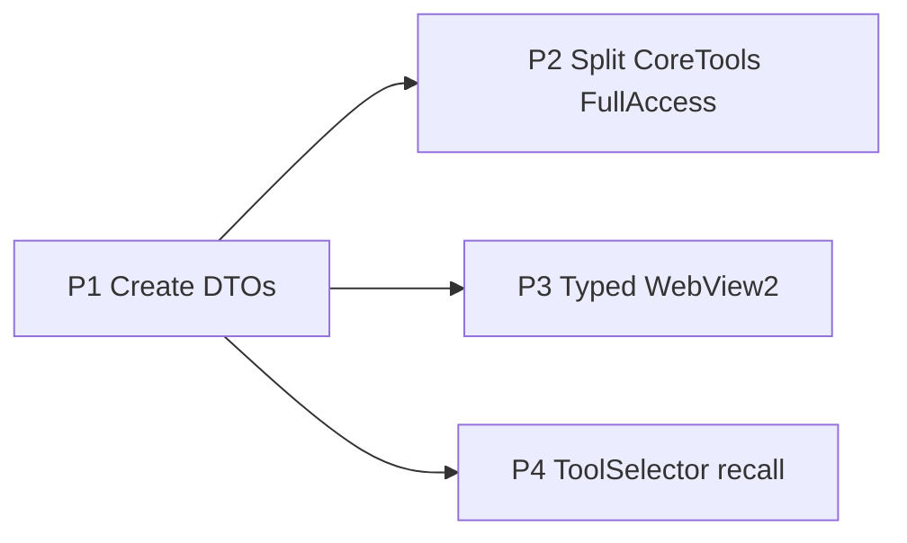

# ADR-0001 — Bridge-first hardening

- Status: Accepted
- Date: 2026-04-08
- Deciders: LoadingAI architecture

## Context

`LoadingAI.Core` is netstandard2.0 and Revit-free. Plugins talk to the model through `IRevitBridge` DTOs. The host (`AdapterRevitBridge`) owns `ExternalEvent` and nested `Transaction`s; `ChatSession` owns the turn `TransactionGroup` and L3 confirm.

Gaps:

1. `IRevitCreateCommand` is empty. `create_wall`, `create_family_instance`, and `duplicate_element` still call `IRawRevitAccess` even though delete/move already use the bridge.
2. `CoreToolsPlugin` implements `IRevitFullAccess` for the whole plugin, so query tools that only need `context.Bridge` still receive raw `UIApplication`.
3. WebView2 traffic is an untyped string switch in `HostPage` vs a union in `web/src/bridge.ts`.
4. `ToolSelector` hard-caps 24 tools with AlwaysKeep `get_model_summary`, `get_selection_summary`, `get_element_details`. No recall of tools dropped after the first round.

## Decision

Sequence P1 then P2. Run P3 and P4 in parallel after P1. Do not raise the 24-cap until P4 pins a fail. Do not add new FullAccess tools.

### P1 — Create command DTOs (this change)

Close `IRevitCreateCommand`:

- `CreateWallAsync(levelName, x1, y1, x2, y2, wallTypeName?)`
- `CreateFamilyInstanceAsync(symbolName, x, y, familyName?, levelName?, z?)`
- `DuplicateElementAsync(elementId)`

Units: tools pass millimetres. Adapter converts with `Metric.MmToFt`. Nested `Transaction` inside Adapter (same as delete/move). Host already `EnsureTurnGroupAsync` on the first L2/L3 write — do not start a second group.

GeometryCreate (floor / roof / grid / array / rotate / mirror / split / join) is closed on `IRevitCreateCommand`; tools live in `GeometryTools.Create` and pass millimetres. Adapter converts. `split_wall` stays not-implemented at the Adapter and is not registered as a catalog tool.

`save_document` is closed on `IRevitDocumentCommand.SaveDocumentAsync`. Tool lives in `DocumentTools.Create` (Bridge-only Core). Adapter calls `doc.Save()` **without** a Transaction. Unsaved documents (empty `PathName`) fail with the original message.

View color (`override_color_in_view`, `color_by_construction_schedule`, `color_by_parameter`) is closed on `IRevitViewCommand`. Tools live in `ViewTools.Create` (Bridge-only Core, L2, no `RequiresWriteConfirm`). Adapter owns ParseColor / palette / ReadParam and wraps `SetElementOverrides` / `SetCategoryOverrides` in a Transaction. Schedule runs in one `RunAsync` (no preview pass).

Param mutate (`rename_elements`, `apply_construction_dates`) is closed on `IRevitParamCommand`. Tools live in `ParamTools.Create` (Bridge-only Core, L3, `RequiresWriteConfirm=true`). Adapter wraps `el.Name` and `TrySetParameter` in a Transaction. Dates run in one `RunAsync` (no preview pass). Host still owns L3 TaskDialog.

QueryHealth (worksets / phases / design options / sheets+views / family types / materials / room area / clash AABB / model health) is closed on `IRevitQuery`. Tools live in `QueryTools.Create` (Bridge-only Core, L1, no `RequiresWriteConfirm`). Adapter has no Transaction. `get_room_area` stays distinct from `get_rooms`. Clash unknown categories return `ClashResultDto.Error` (no `"Failed:"` prefix); invalid JSON returns `Invalid args` before Bridge.

ParamExcel (`export_params_to_excel`, `import_excel_to_params`, `copy_params`, `replace_text`, `numbering_auto`) is closed on `IRevitParamCommand`. Tools live in `ParamTools.Create` (Bridge-only Core). Tiers stay Compat: export L1 (no confirm), copy/replace/number L2 + `RequiresWriteConfirm=true`, import L3 + `RequiresWriteConfirm=true`. CSV I/O stays in the handler (`ExportPaths` + `File`); Adapter does Revit collect/set only. Export has no Transaction; writes wrap `TrySetParameter` in a Transaction. Unknown category is `ParamExportDto.Error` / `CommandResultDto.Message` without `"Failed:"`. Import file-not-found / empty / no rows never hit Bridge. Invalid numbering JSON still calls Bridge (Compat `catch{}`).

SheetDoc (`create_sheet`, `place_view_on_sheet`, `duplicate_view_ex`, `set_view_template`, `set_crop_box`, `create_dimension`, `tag_all`) is closed on `IRevitViewCommand`. Tools live in `ViewTools.Create` (Bridge-only Core). Tiers stay Compat: create_sheet L3 + `RequiresWriteConfirm=true`; place/dimension/tag L3 no confirm; duplicate/template/crop L2 no confirm. Handler `place_view_on_sheet` passes millimetres; Adapter converts with `Metric.MmToFt` and success text stays in feet. Dimension offsets stay feet in Adapter. `tag_all` Take(50). Invalid JSON is `Invalid args` (no `{}` fallback). Host still owns L3 TaskDialog.

Worksharing (`reload_links`, `workset_assign`, `sync_info`, `audit_warnings_fix`) stays on existing slices — no new capability interface. Reads: `sync_info` and `audit_warnings_fix` live in `QueryTools.Create` beside `get_document_info` / `get_warnings` (keep those public names). `audit_warnings_fix` uses `IRevitQuery.GetWarningsRawAsync` (ungrouped Take, Clamp 1–50) so grouping vs raw stays obvious. Writes: `reload_links` and `workset_assign` live in `DocumentTools.Create` on `IRevitDocumentCommand`. Adapter wraps both writes in a Transaction (`failEx` if inner `ex` exists). Save stays **without** a Transaction. Tiers stay Compat: reload/assign L2 no `RequiresWriteConfirm`; sync/audit L1. Invalid assign JSON is `Invalid args`; invalid audit JSON `catch{}` still calls Bridge.

IfcCost (`quantity_takeoff_by_category`) is closed on `IRevitQuery.GetQuantityTakeoffAsync` — no new capability interface. Totals and row measures stay feet in `QuantityTakeoffDto`; CSV I/O and Metric conversion stay in the `QueryTools` handler (`ExportPaths` + `File`), same pattern as ParamExcel. Do **not** reuse `GetQuantitiesAsync` (category counts, totals always 0) or `GetElementQuantitiesAsync` (selection/ids, Take(50), bounding box). Unknown category is DTO.Error `"Unknown category {cat}"` (no `"Failed:"`). Invalid JSON is `Invalid args` (no `{}` fallback). Adapter has no Transaction. Public name stays `quantity_takeoff_by_category`. Keep `get_quantities`.

### P2 — Split core-tools FullAccess (this change)

Grant raw `UIApplication` only to tools that still need it.

- `CoreToolsPlugin` is the single type in the folder (`AllTools.CreateBridge`). It does not implement `IRevitFullAccess`, so PluginLoader never supplies `IRawRevitAccess`. Empty `CoreToolsFullAccessPlugin` and `CreateFullAccess` are gone. Plugin `AllTools` is Autodesk-free; parse wrappers live on host `src/LoadingAI/Tools/AllTools.cs`. csproj references Core only (no RevitUtil / Nice3point). Other shipped plugins still implement `IRevitFullAccess`.
- Color overrides, SheetDoc, `save_document`, param mutate, QueryHealth, ParamExcel, Worksharing, and IfcCost are Bridge-only Core (`ViewTools` / `DocumentTools` / `ParamTools` / `QueryTools`). Leftover FullAccess in core-tools: none.
- Cache `AdapterRevitBridge` on `PluginContext` (one instance per context, not `new` per `Bridge` get).

### P3 — Typed host page protocol (this change)

`HostPage` dispatches on `ToHostMessage` (`src/LoadingAI.Core/Protocol/HostProtocol.cs`). Host→web posts are `FromHostMessage` records; `Serialize` uses runtime type. Kinds match `web/src/bridge.ts` `ToHost` / `FromHost`. Unknown `type` is ignored. Bad JSON / missing `type` posts `Bridge error`. Quota never includes `ticket`. L3 TaskDialog, dry-run skip, preset native confirm, and turn `TransactionGroup` stay in `ApprovalGate` / `ChatSession`.

### P4 — ToolSelector recall (this change)

Keep cap 24. `Select` still ranks the first round. `Recall` re-scores dropped catalog tools against later-round text (user + recent tool names/results) and swaps the lowest non-AlwaysKeep slots. AlwaysKeep stays; size stays ≤ 24. `AgentLoop` calls `Recall` from round 1 onward. Do not raise `DefaultMax` until a named tool still fails after recall.

## Consequences

- Create handlers run under FakeRevitBridge in hosted CI (`FullAccess` is null there).
- Family-instance success text is millimetres at the tool boundary (Adapter converts).
- Gateway client token remains identity, not a secret — out of scope.

## Follow-up

Week 1: P1 in tree.
Week 2: P2 plugin split (this change).
Week 3: P3 protocol (this change) + P4 selector recall (this change). P3 follow-up: typed FromHost posts (this change).
