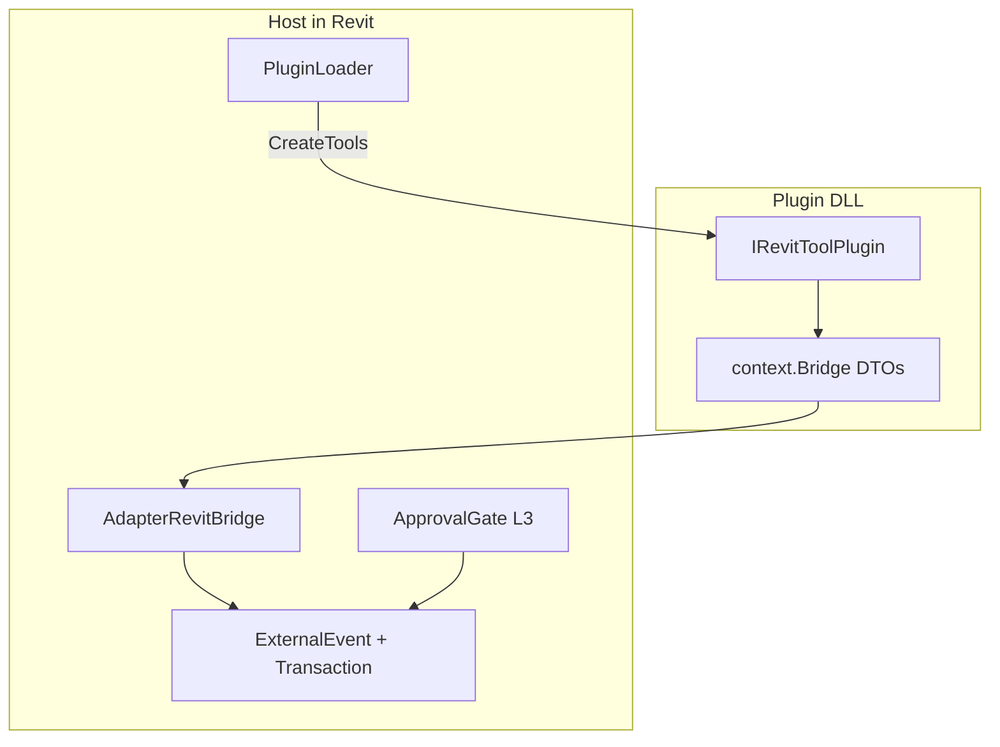

# ADR-0002 — Plugin shelf: Core-only, Bridge-first, never host

- Status: Accepted
- Date: 2026-09-18
- Deciders: LoadingAI architecture
- Extends: [ADR-0001](0001-bridge-first-hardening.md) (does not supersede it)

## Context

LoadingAI ships tools as drop-in plugins (`Plugins/<id>/`), not as types inside `src/LoadingAI`.
The host process owns the Revit UI thread (`ExternalEvent`), turn `TransactionGroup`, and L3 confirm.
Plugins must stay unloadable and testable without Revit.exe.

Without a recorded shelf contract, a new plugin can ProjectReference the host, call `Document` off-thread, or grow the LLM catalog past the 24-tool cap.

## Options considered

1. **In-process plugin shelf, Core-only (chosen)** — MIT folders under `Plugins/`, `IRevitToolPlugin` + `context.Bridge`, host never referenced. Matches CONTRIBUTING and `PluginProjectContractTests`.
2. **Tools compiled into the host** — simpler load, but every tool change rebuilds the add-in and FullAccess leaks into Core.
3. **Out-of-process plugin RPC** — safer isolation, but Revit API is in-process only; every model op would hop a process for no gain.

## Decision

- A plugin is a folder `Plugins/<id>/` with `plugin.json` + csproj + C#. Never `src/LoadingAI.Plugins.*`.
- Entry type implements `IRevitToolPlugin`. `CreateTools` uses `IPluginContext`.
- csproj ProjectReferences `LoadingAI.Core` only, unless ADR-0003 applies.
- **Never** ProjectReference `src/LoadingAI/LoadingAI.csproj`.
- Default path is **Bridge-first**: `context.Bridge` (`IRevitQuery` / view / param / create / document). No `Autodesk.Revit` in a plugin that omits `IRevitFullAccess`.
- Units at the tool boundary: millimetres / m² / m³. Adapter converts (`Metric.MmToFt`). CSV / filesystem I/O stays in the handler, not in the Adapter.
- Host owns pick (`PresetFieldKind.PickElements` / `PickBox`). Plugins do not call `Selection.PickObjects`.
- Host owns L3 `TaskDialog` and the turn `TransactionGroup`. Nested tool `Transaction`s fold in; plugins do not start a second group.
- `ToolRegistry.Register` overwrites by name (case-insensitive). Duplicate public names are a bug — do not ship two tools with the same `Function.Name`.
- L3 tools `enabledByDefault: false`. Tags live on `plugin.json` / `ToolEntry.Tags`, never on `ToolDefinition` (that JSON goes to the LLM).
- ToolSelector cap stays **24** (ADR-0001). New tools compete on score + Recall; they do not raise `DefaultMax`.
- Shipped example of Bridge-only: `Plugins/core-tools` and `Plugins/example.hello`.
- Contract tests: `ShippedPlugin_DoesNotReferenceHost`, `HelloPlugin_IsBridgeOnly`, `NonFullAccessPlugins_DoNotMentionAutodeskRevit`.

## Consequences

- Hosted CI can run Bridge tools against `FakeRevitBridge` (`FullAccess` is null).
- A plugin that needs raw Revit must follow ADR-0003, not this file.
- Reload still requires restart when the DLL is locked (AppDomain / ALC). That is accepted.

## Do not

- Do not reference the host project from a plugin.
- Do not mention `Autodesk.Revit` unless the plugin implements `IRevitFullAccess` (ADR-0003).
- Do not add pick APIs to `IRevitBridge`.
- Do not put File I/O inside `AdapterRevitBridge`.
- Do not raise ToolSelector `DefaultMax` above 24.
- Do not add FullAccess tools to `core-tools`.
- Do not call `AllTools.Parse*` from plugin Query/Param handlers (host parse wrappers stay on host `src/LoadingAI/Tools/AllTools.cs`).
