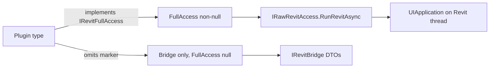

# ADR-0003 — FullAccess is opt-in and listed

- Status: Accepted
- Date: 2026-09-18
- Deciders: LoadingAI architecture
- Extends: [ADR-0002](0002-plugin-shelf-bridge-first.md)
- Does not supersede: [ADR-0001](0001-bridge-first-hardening.md)

## Context

ADR-0001 made `core-tools` Bridge-only. Other shipped plugins still need Autodesk types the Bridge does not expose: PDF/DWG/IFC export, schedules/views, formwork solids, beam/floor cuts. `modeling-tools` moved onto Bridge in [ADR-0005](0005-port-modeling-tools-onto-bridge.md).

`IRevitFullAccess` is an **empty marker**. The host (`PluginLoader`) sets `requestFull = typeof(IRevitFullAccess).IsAssignableFrom(pt)` and only then supplies `IPluginContext.FullAccess` (`IRawRevitAccess`). `FakePluginContext.FullAccess` is always null, so FullAccess handlers cannot run in hosted CI.

If FullAccess is treated as the default, every new plugin gets `UIApplication` and Core’s “no RevitAPI” rule dies.

## Options considered

1. **Empty marker + listed exceptions (chosen)** — plugin class implements `IRevitFullAccess`; csproj adds RevitUtil + Nice3point (`Private=false`, `ExcludeAssets=runtime`). Host still wraps work in `RunRevitAsync` / ExternalEvent.
2. **Grow `IRevitBridge` until FullAccess is gone** — right long-term for each op that has a stable DTO; wrong as a blanket. Export/schedules/formwork/cuts are not DTO-ready. Migrating them is a **new ADR per plugin**, not a silent Bridge dump.
3. **Give every plugin raw access** — rejected in ADR-0001 P2. Query tools must not receive `UIApplication`.

## Decision

**Listed FullAccess plugins (today):**

| Plugin id | Why FullAccess |
|---|---|
| `export-tools` | `export_pdf`, `export_dwg`, `export_ifc`, `purge_unused` |
| `view-tools` | schedules, floor/3d/section views, path of travel |
| `qs-formwork` | formwork solids / panels |
| `structure-cuts` | beam/floor/level/grid splits |

**Rules for those plugins**

- Implement `IRevitFullAccess` on the plugin class (the marker), not on each tool.
- Reference `LoadingAI.RevitUtil` + Nice3point RevitAPI. Still **never** reference the host csproj.
- Model work runs through `context.FullAccess.RunRevitAsync` (Revit UI thread). No `Document` access off-thread.
- Writes still go through host L2/L3 gates. Dry-run skips the L3 TaskDialog. Plugins do not show their own confirm for L3.
- Hosted tests cover `CreateTools` shape + dry-run skip reasons only. Live writes stay in `LoadingAI.RevitTests` (local Revit 2027).

**Not FullAccess**

- `core-tools`, `example.hello`, `modeling-tools`, and any new plugin that can be expressed with existing Bridge slices.
- PluginLoader `requestFull` stays. Do not delete the marker to “simplify” core-tools.

Moving a row in the table onto Bridge is a **new ADR** (0004+), one plugin (or one DTO slice) at a time, with FakeBridge tests before deleting the marker.

## Consequences

- `NonFullAccessPlugins_DoNotMentionAutodeskRevit` skips a folder only if some `.cs` contains `IRevitFullAccess`. Removing the marker from a listed plugin without a Bridge port **fails CI**.
- `ShippedPlugin_DoesNotReferenceHost(..., requiresRevitUtil: true)` locks RevitUtil on the four listed plugins.
- Fake tests must not call FullAccess factories; `FullAccess` is null.

## Do not

- Do not add FullAccess tools to `core-tools`.
- Do not implement `IRevitFullAccess` on a new plugin unless this table gains a row in a new ADR (or this file is updated in the same PR that adds the plugin, with a why).
- Do not pass `UIApplication` through Core.
- Do not migrate view / export / qs-formwork / structure-cuts onto Bridge in a drive-by PR.
- Do not remove PluginLoader `requestFull`.
- Do not call `Selection.PickObjects` from a FullAccess plugin; declare presets and let the host pick.
