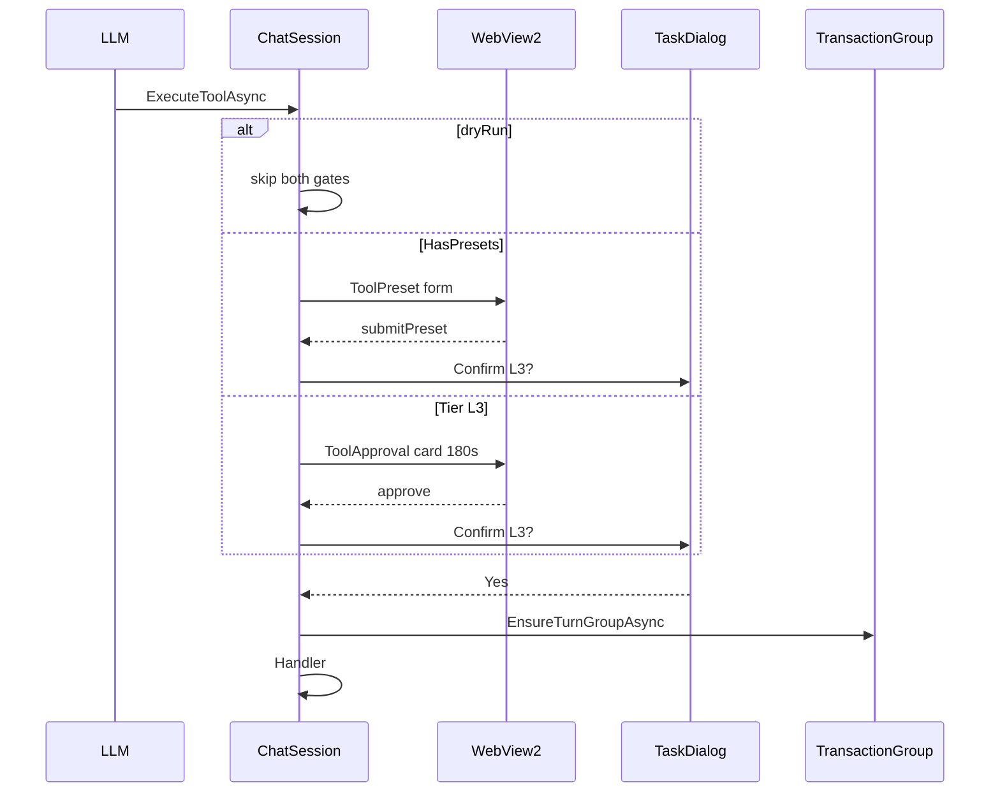

# ADR-0004 — Host-owned L3 confirm

- Status: Accepted
- Date: 2026-09-19
- Deciders: LoadingAI architecture
- Extends: [ADR-0002](0002-plugin-shelf-bridge-first.md)
- Does not supersede: [ADR-0001](0001-bridge-first-hardening.md), [ADR-0003](0003-fullaccess-exceptions.md)

## Context

L2/L3 writes can delete, move, create, or mutate the open model. The host already owns the turn `TransactionGroup` (ADR-0002). Confirm is also host-owned, but 0001–0003 never froze the **order** of gates.

Today `ChatSession.ExecuteToolAsync` does this:

- Plain L3: web `ToolApproval` (TCS, 180s) **then** native `Confirm L3:` TaskDialog (default No).
- L3 with presets: chat `ToolPreset` form **then** native `Confirm L3:`. No web approval card (the form is the web step).
- `ToolPresets.IsDryRun(argsJson)`: skip **both** gates. Generic merged-JSON check, not a tool-name allowlist.
- `ToolGuards.ApplyConfirm` skips L1, L3, `RequiresWriteConfirm`, and preset tools. L2 without presets still gets a host TaskDialog.

A later PR can drop the native dialog (web-only), drop the web card (native-only), or skip dry-run and double-prompt a preview. That is a product freeze, not a bugfix. Record it before anyone “simplifies” the gate.

## Options considered

1. **Web then native, freeze as-is (chosen)** — chat can Approve/Deny without stealing Revit’s focus; native TaskDialog is the last gate on the UI thread before `EnsureTurnGroupAsync`. Matches `UsabilityContractTests` today.
2. **Native only** — one click, but the pane cannot Approve while Revit is behind another window, and Stop/DenyAll cannot cancel a modal TaskDialog already showing.
3. **Web only** — one click in the pane, but an accidental Approve in WebView2 would start an L3 write with no Revit-thread confirm (default No is the safety).

## Decision

- Host owns every confirm. Plugins and `src/LoadingAI/Tools/**` (except `ToolGuards.cs`) must not `new TaskDialog`.
- Native instruction text is `Confirm L3: {name}?`. Default button **No**. Applies to **every** L3 tool, not a name allowlist (`delete_elements` / `move_elements` only is forbidden).
- Dry-run skip: `entry.Tier == ToolTier.L3 && !ToolPresets.IsDryRun(argsJson)` on **both** the preset branch and the plain-L3 branch. Do not list split-beam / split-floor tool names in `ChatSession`.
- Preset L3: skip `AwaitL3WebAsync`. Keep `ConfirmL3NativeAsync` after merge. L2 with presets: the form is the confirm (`ToolGuards` must not wrap a second TaskDialog).
- Plain L3: `AwaitL3WebAsync` then `ConfirmL3NativeAsync`. Timeout 180s → `"Cancelled: approval timeout (180s)."` Deny → `"Cancelled by user (denied)."` Native No → `"Cancelled by user."`
- Stop / Cancel calls `ApprovalGate.DenyAllPending` (web TCS + presets). Native TaskDialog is modal on the Revit thread; do not try to dismiss it from the pane.
- After both gates pass (or dry-run skip), first L2 / non-dry-run L3 in the turn starts `EnsureTurnGroupAsync`. Finish with `CancellationToken.None`.
- Pick stays host-owned (`PresetPickHost`). Do not add pick to `IRevitBridge` (ADR-0002).

## Consequences

- Accidental web Approve still faces default-No on Revit’s UI thread.
- Two prompts on plain L3 is **intentional**, not a sitting gap.
- Tests that lock this (already in tree — this ADR does not add code):
  - `HostPage_L3NativeConfirm_AppliesToEveryL3Tool`
  - `HostPage_SkipsL3ConfirmForDryRun_ViaGenericArgCheck`
  - `HostPage_PresetMessages_SkipL3WebCardKeepNativeConfirm`
  - `ToolGuards_SkipsL3_HostOwnsTheGate`
  - `AllToolScripts_DoNotShowTheirOwnTaskDialog`
- Status **Accepted**: Decision matches `ChatSession` / `ApprovalGate` / `ToolGuards` with no behavior change. A later PR that needs a different gate writes a new ADR first.

## Do not

- Do not drop native `Confirm L3:` for a web-only L3 path.
- Do not drop the web approval card for plain L3 (native-only) without a new ADR.
- Do not skip native confirm when the tool has presets.
- Do not skip dry-run with a tool-name allowlist.
- Do not `new TaskDialog` in a plugin or in a tool file other than `ToolGuards.cs`.
- Do not start `TransactionGroup` before the gates (or on L1 / dry-run).
- Do not add pick APIs to `IRevitBridge`.
- Do not raise ToolSelector `DefaultMax` (ADR-0001 / 0002).
