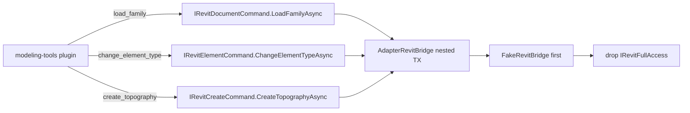

# ADR-0005 — Port modeling-tools onto Bridge

- Status: Accepted
- Date: 2026-09-19
- Deciders: LoadingAI architecture
- Extends: [ADR-0003](0003-fullaccess-exceptions.md)
- Does not supersede: [ADR-0001](0001-bridge-first-hardening.md), [ADR-0002](0002-plugin-shelf-bridge-first.md), [ADR-0003](0003-fullaccess-exceptions.md), [ADR-0004](0004-host-owned-l3-confirm.md)

## Context

ADR-0003 lists `modeling-tools` as FullAccess because family load had no DTO. That freeze forbids a silent Bridge dump: moving a row is a **new ADR**, one plugin or one DTO slice, with FakeBridge tests before deleting `IRevitFullAccess`.

The three tools already have stable inputs (`path`, `elementId` + `typeName`/`typeId`, millimetre `[x,y,z]` points). They return `CommandResultDto` text. Units at the tool boundary are already millimetres (`create_topography`). `File.Exists` for `load_family` is handler I/O, not Adapter work.

`IRevitElementCommand` / `IRevitCreateCommand` / `IRevitDocumentCommand` still comment “Family load and export stay on `IRawRevitAccess`”. That comment is the freeze this ADR names. Export / schedules / formwork / beam-floor cuts still need Autodesk types the Bridge does not expose.

Skipping this file and deleting the marker in a drive-by PR breaks ADR-0003.

## Options considered

1. **Whole `modeling-tools` on existing slices (chosen)** — three methods, no new Bridge interface, smallest complete row to drop from the 0003 table.
2. **One slice only (`change_element_type`)** — smaller diff, but the plugin stays FullAccess for the other two tools, so the row cannot leave the table.
3. **Port `export-tools` / `view-tools` / `qs-formwork` / `structure-cuts` instead** — those ops are not DTO-ready (PDF/DWG/IFC paths, schedules/POT, DirectShape/schema, native splits). ADR-0003 already rejected a blanket dump.

## Decision



Port **all three** tools. Keep them in `Plugins/modeling-tools/` (id `modeling-tools`). Do not fold them into `core-tools`.

Add these signatures (millimetres at the Bridge; Adapter converts with `Metric.MmToFt`):

```csharp
// IRevitDocumentCommand
Task<CommandResultDto> LoadFamilyAsync(string path, CancellationToken ct = default);

// IRevitElementCommand
Task<CommandResultDto> ChangeElementTypeAsync(
    string elementId, string? typeName = null, string? typeId = null,
    CancellationToken ct = default);

// IRevitCreateCommand
Task<CommandResultDto> CreateTopographyAsync(
    IReadOnlyList<PointMmDto> points,
    string? levelName = null, string? levelId = null,
    CancellationToken ct = default);

public sealed record PointMmDto(double X, double Y, double Z);
```

- Adapter owns nested `Transaction` (`LoadFamily` / `ChangeTypeId` / `Toposolid.Create`), type/level resolve, and mm→ft. Do not start a second turn `TransactionGroup`.
- Handler owns `File.Exists` for `load_family`. Adapter does not read the filesystem except `Document.LoadFamily(path)`.
- Host still owns L3 gates (ADR-0004: web then native; presets skip web; dry-run skips both) and the turn group. Plugin stays `ToolTier.L3`, `enabledByDefault: false`. No `new TaskDialog`.
- Update the three slice comments: family load is on `IRevitDocumentCommand`; export stays on `IRawRevitAccess`.
- **Order when code lands:** implement the three methods on `AdapterRevitBridge` **and** `FakeRevitBridge`, lock names in `L3CommandContractTests`, then delete the marker, drop RevitUtil + Nice3point from `ModelingToolsPlugin.csproj`, flip `ShippedPlugin_DoesNotReferenceHost(..., requiresRevitUtil: false)` for `modeling-tools`. Do not delete the marker first.
- This Proposed file does **not** rewrite the ADR-0003 table. When this ADR is **Accepted** and the matching PR merges, remove the `modeling-tools` row from 0003 in that same PR.

## Consequences

- `modeling-tools` becomes Bridge-only. Hosted CI can run the three handlers against `FakeRevitBridge` (`FullAccess` is null).
- Export / view / formwork / cuts remain FullAccess until their own ADRs.
- Tests that lock this when code lands:
  - `L3CommandContractTests` — `LoadFamilyAsync`, `ChangeElementTypeAsync`, `CreateTopographyAsync` on the named slices; still `DoesNotContain` across the wrong slices.
  - `FakeRevitBridge` implements all three (no-doc → `"Please open a model first."`).
  - `ShippedPlugin_DoesNotReferenceHost` `requiresRevitUtil: false` for `Plugins/modeling-tools/ModelingToolsPlugin.csproj`.
  - `NonFullAccessPlugins_DoNotMentionAutodeskRevit` covers the folder after the marker is gone.
  - `ModelingPlugin_DoesNotDuplicateCoreTools` still asserts the three public names stay in this plugin.
- Status stays **Proposed** until that code matches. Do not flip to Accepted in a docs-only PR.

## Do not

- Do not grow `IRevitBridge` for `export-tools`, `view-tools`, `qs-formwork`, or `structure-cuts` in this ADR.
- Do not add these three tools to `core-tools`.
- Do not add a new Bridge interface; use the existing document / element / create slices.
- Do not put `File.Exists` / CSV I/O inside `AdapterRevitBridge`.
- Do not convert millimetres in the plugin handler; Adapter converts.
- Do not add pick APIs to `IRevitBridge` (ADR-0002 / 0004).
- Do not change the L3 gate order (ADR-0004).
- Do not raise ToolSelector `DefaultMax` (ADR-0001 / 0002).
- Do not rewrite the ADR-0003 table in this Proposed file.
- Do not delete `IRevitFullAccess` on `ModelingToolsPlugin` before FakeBridge + contract tests exist.
- Do not `new TaskDialog` in the plugin.
- Do not start a plugin-owned `TransactionGroup`.
