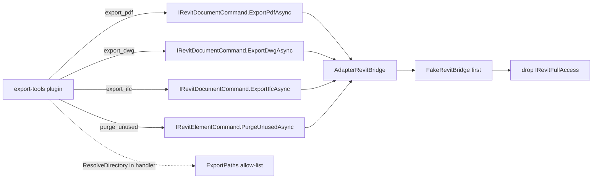

# ADR-0006 — Port export-tools onto Bridge

- Status: Accepted
- Date: 2026-09-20
- Deciders: LoadingAI architecture
- Extends: [ADR-0003](0003-fullaccess-exceptions.md)
- Does not supersede: [ADR-0001](0001-bridge-first-hardening.md), [ADR-0002](0002-plugin-shelf-bridge-first.md), [ADR-0003](0003-fullaccess-exceptions.md), [ADR-0004](0004-host-owned-l3-confirm.md), [ADR-0005](0005-port-modeling-tools-onto-bridge.md)

## Context

ADR-0003 lists `export-tools` as FullAccess because PDF / DWG / IFC export and purge had no DTO. That freeze forbids a silent Bridge dump: moving a row is a **new ADR**, one plugin or one DTO slice, with FakeBridge tests before deleting `IRevitFullAccess`.

Three facts make this row cheaper than ADR-0003 assumed:

- The tool inputs are already plain: `folder`, `name`, `sheetIds` / `viewIds`, `version`, `preview`. Nothing needs an Autodesk type at the plugin boundary.
- `ExportPaths` (`src/LoadingAI.Core/Llm/ExportPaths.cs`, namespace `LoadingAI.Revit`) already owns the folder allow-list (`Root`, `ResolveDirectory`, `IsUnderRoot`) and file-name cleaning (`SanitizeFileName`). The plugin already ran that policy before calling FullAccess.
- Revit exports are **not** Transactions. They return `bool`, so they map onto `CommandResultDto` directly. Only `purge_unused` mutates, and it already needed a `Transaction`.

The stale comments on `IRevitElementCommand` / `IRevitCreateCommand` / `IRevitDocumentCommand` (“Family load and export stay on `IRawRevitAccess`”) are the freeze this ADR names.

Skipping this file and deleting the marker in a drive-by PR breaks ADR-0003.

## Options considered

1. **Whole `export-tools` on existing slices (chosen)** — three methods on `IRevitDocumentCommand`, one on `IRevitElementCommand`, one DTO. No new interface, smallest complete row to drop from the 0003 table.
2. **Port `purge_unused` only** — smaller diff, but the plugin stays FullAccess for the three exports, so the row cannot leave the table.
3. **New `IRevitExportCommand` slice** — cleaner naming, but ADR-0002 / 0005 keep the Bridge to the existing narrow slices; a fourth interface is a bigger freeze than the row it removes.
4. **Port `view-tools` / `qs-formwork` / `structure-cuts` instead** — schedules / POT / DirectShape / native splits are not DTO-ready. ADR-0003 already rejected a blanket dump.

## Decision



Port **all four** tools. Keep them in `Plugins/export-tools/` (id `export-tools`). Do not fold them into `core-tools`.

Add these signatures:

```csharp
// IRevitDocumentCommand
Task<CommandResultDto> ExportPdfAsync(
    string directory, IReadOnlyList<string>? sheetIds = null,
    string? fileName = null, bool combine = true, CancellationToken ct = default);

Task<CommandResultDto> ExportDwgAsync(
    string directory, IReadOnlyList<string>? viewIds = null,
    string? fileName = null, CancellationToken ct = default);

Task<CommandResultDto> ExportIfcAsync(
    string directory, string? fileName = null,
    string? version = null, CancellationToken ct = default);

// IRevitElementCommand
Task<PurgeUnusedResultDto> PurgeUnusedAsync(bool preview = true, CancellationToken ct = default);

public sealed record PurgeUnusedResultDto(
    bool Preview, int UnusedCount, int DeletedCount, int Passes,
    IReadOnlyList<string> Sample, string? Error = null);
```

- `directory` is an **absolute, pre-validated** path. The Adapter never re-checks it and never calls `ExportPaths` for policy; the handler keeps `ExportPaths.ResolveDirectory`.
- `null` / empty `sheetIds` / `viewIds` means “all printable sheets” (PDF) or “active view” (DWG). The handler normalises an empty list to `null`.
- `SanitizeFileName` moves into the Adapter, because the fallback is `doc.Title`. It is pure string work, not filesystem I/O.
- Exports run with the Adapter-private `ExportTimeout` (10 min), not `RevitBridge.DefaultTimeout`. The timeout is **not** on the Bridge signature.
- Adapter owns the `Transaction` for `purge_unused` only; exports stay transaction-free. Do not start a second turn `TransactionGroup`.
- `purge_unused` preview collects a ≤15-item sample and mutates nothing; delete loops `GetUnusedElements` + `Document.Delete` in one `Transaction` (≤8 passes) and rolls back on failure.
- Host still owns L3 gates (ADR-0004: web then native; presets skip web; dry-run skips both) and the turn group. Tiers do not change: `export_pdf` / `export_dwg` / `export_ifc` stay `ToolTier.L1`, `purge_unused` stays `ToolTier.L3`, `enabledByDefault: false`. No `new TaskDialog`.
- Update the three slice comments: export is on `IRevitDocumentCommand`, purge is on `IRevitElementCommand`.
- **Order when code lands:** implement the methods on `AdapterRevitBridge` **and** `FakeRevitBridge`, lock names in `L3CommandContractTests`, then delete the marker, drop RevitUtil + Nice3point from `ExportToolsPlugin.csproj`, flip `ShippedPlugin_DoesNotReferenceHost(..., requiresRevitUtil: false)` for `export-tools`. Do not delete the marker first.
- This ADR removes the `export-tools` row from 0003 in the same PR that lands the code.

## Consequences

- `export-tools` becomes Bridge-only. Hosted CI can run all four handlers against `FakeRevitBridge` (`FullAccess` is null).
- `ExportPaths` is now the single place that decides what a legal export folder is, and it is enforced before any Revit call.
- `view-tools` / `qs-formwork` / `structure-cuts` remain FullAccess until their own ADRs.
- Long PDF/DWG/IFC exports block the Revit thread for up to `ExportTimeout`; the host turn token still cancels the queue, not Revit itself.
- Tests that lock this:
  - `L3CommandContractTests` — the four new names on the named slices; `DoesNotContain` across the wrong slices.
  - `FakeRevitBridge` implements all four (no-doc → `"Please open a model first."`).
  - `FakeBridgeToolTests` — the four handlers, including the `ExportPaths` reject path and the purge preview / delete / empty branches.
  - `ShippedPlugin_DoesNotReferenceHost` `requiresRevitUtil: false` for `Plugins/export-tools/ExportToolsPlugin.csproj`.
  - `NonFullAccessPlugins_DoNotMentionAutodeskRevit` covers the folder after the marker is gone.

## Do not

- Do not grow `IRevitBridge` for `view-tools`, `qs-formwork`, or `structure-cuts` in this ADR.
- Do not add `IRevitExportCommand` or any new Bridge interface; use the existing document / element slices.
- Do not re-validate the export folder inside the Adapter, and do not add other filesystem I/O there.
- Do not delete `IRevitFullAccess` on `ExportToolsPlugin` before FakeBridge + contract tests exist.
- Do not run exports inside a `Transaction`.
- Do not change the L1/L3 tiers, `RequiresWriteConfirm`, or the L3 gate order (ADR-0004).
- Do not put `ExportTimeout` on the Bridge signature; it stays Adapter-private.
- Do not move `purge_unused` onto the preview code path without a `Transaction`; delete is one transaction, not one per element.
- Do not `new TaskDialog` in the plugin.
- Do not start a plugin-owned `TransactionGroup`.
