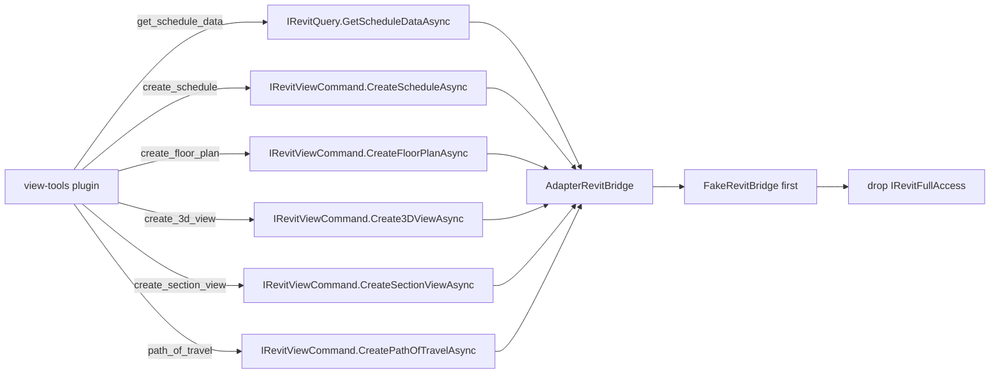

# ADR-0007 — Port view-tools onto Bridge

- Status: Accepted
- Date: 2026-09-21
- Deciders: LoadingAI architecture
- Extends: [ADR-0003](0003-fullaccess-exceptions.md)
- Does not supersede: [ADR-0001](0001-bridge-first-hardening.md), [ADR-0002](0002-plugin-shelf-bridge-first.md), [ADR-0003](0003-fullaccess-exceptions.md), [ADR-0004](0004-host-owned-l3-confirm.md), [ADR-0005](0005-port-modeling-tools-onto-bridge.md), [ADR-0006](0006-port-export-tools-onto-bridge.md)

## Context

ADR-0003 lists `view-tools` as FullAccess because schedules, new views, and path of travel had no DTO. That freeze forbids a silent Bridge dump: moving a row is a **new ADR**, one plugin or one DTO slice, with FakeBridge tests before deleting `IRevitFullAccess`.

Four facts make this row cheaper than ADR-0003 assumed:

- The tool inputs are already plain numbers and names: `category`, `fields`, `levelId` / `levelName`, `x1,y1,x2,y2`, `starts` / `ends`, `startX` / `startY`. Nothing at the plugin boundary needs an Autodesk type.
- The plugin never used `FullAccess` for anything but `UIApplication.ActiveUIDocument` and the `Document` — no `Selection`, no `TaskDialog`, no file I/O. `context.Bridge` already reaches both.
- `PointMmDto` and the `Metric.MmToFt` convention already exist for every other create tool (ADR-0001), so the section box and the path endpoints reuse them instead of inventing a second unit system.
- Everything here is a **write**, so the host's native `Confirm L3: {name}?` (ADR-0004) already covers every call. The plugin needs no confirm of its own and no preset change.

`get_schedule_data` is the one read in the plugin, and it was the only tool that could not be answered from an existing DTO: `ScheduleDataDto` is genuinely new.

Skipping this file and deleting the marker in a drive-by PR breaks ADR-0003.

## Options considered

1. **Whole `view-tools` on existing slices (chosen)** — one read on `IRevitQuery`, five creates on `IRevitViewCommand`, four DTOs. No new interface, smallest complete row to drop from the 0003 table.
2. **Create-only port** — `create_schedule` / `create_floor_plan` / `create_3d_view` / `create_section_view` are straightforward, but leaving `get_schedule_data` and `path_of_travel` on FullAccess keeps the marker and the row. A partial row is not a row you can drop.
3. **New `IRevitViewCreateCommand` slice** — cleaner naming, but ADR-0002 / 0005 / 0006 keep the Bridge to the existing narrow slices; a seventh interface is a bigger freeze than the row it removes.
4. **Keep `get_schedule_data` on FullAccess and port the rest** — the read is the cheapest method here (`ViewSchedule.GetTableData`), and a mixed plugin still cannot drop RevitUtil from its csproj, so it buys nothing.
5. **Move all six tools into `core-tools`** — rejected in ADR-0002: plugin identity and `enabledByDefault` stay per folder, and `view-tools` has 5 of 6 tools at L3.

## Decision



Port **all six** tools. Keep them in `Plugins/view-tools/` (id `view-tools`). Do not fold them into `core-tools`.

Add these signatures:

```csharp
// IRevitQuery
Task<ScheduleDataDto?> GetScheduleDataAsync(
    string? scheduleId, string? scheduleName, int rowLimit, CancellationToken ct = default);

// IRevitViewCommand
Task<ViewRefDto?> CreateScheduleAsync(
    string name, IReadOnlyList<string> fields, CancellationToken ct = default);

Task<ViewRefDto?> CreateFloorPlanAsync(
    string levelIdOrName, string name, CancellationToken ct = default);

Task<ViewRefDto?> Create3DViewAsync(
    string name, bool isometric, CancellationToken ct = default);

Task<ViewRefDto?> CreateSectionViewAsync(
    string name, PointMmDto min, PointMmDto max,
    string? viewDirection, CancellationToken ct = default);

Task<PathOfTravelResultDto?> CreatePathOfTravelAsync(
    string viewIdOrName, IReadOnlyList<PathPairDto> pairs, CancellationToken ct = default);

public sealed record ViewRefDto(
    string Id, string Name, string Message, string? Error = null);

public sealed record ScheduleDataDto(
    string Id, string Name, int TotalRows, int TotalColumns, int ShownRows,
    IReadOnlyList<IReadOnlyList<string>> Rows, string? Error = null);

public sealed record PathPairDto(PointMmDto Start, PointMmDto End);

public sealed record PathOfTravelResultDto(
    string ViewName, int Requested, int Created,
    IReadOnlyList<string> CreatedIds, IReadOnlyList<string> Failures, string? Error = null);
```

- `CreateScheduleAsync` takes one token because the frozen tool surface has two params (`category`, `name`). The token is `"<category>"` or `"<category>:<schedule name>"`; the Adapter splits on the **first** `:`, names the schedule `"<category> Schedule"` when no explicit name was given, and resolves the category from the token's **leading** words so `"Door List"` still finds `Doors`. This keeps `AllTools.ParseCategory` in the Adapter where it belongs and out of the plugin.
- `CreateFloorPlanAsync` takes one `levelIdOrName`: the handler prefers `levelId`, falls back to `levelName`, and the Adapter treats blank as “lowest level”.
- `isometric` is a real parameter rather than a constant, but the frozen tool surface has no `isometric` arg, so the handler always passes `true` (`View3D.CreateIsometric`). The parameter exists so the slice does not encode a UI decision.
- `min` / `max` are **millimetres** and reuse `PointMmDto`; the same DTO carries the path start/end points. The Adapter converts with `Metric.MmToFt` when it builds the `XYZ` / `BoundingBoxXYZ` / `UV`. Plugins never convert.
- `viewDirection` is an axis token (`x` / `-y` / `z`, also `east` / `north`); when blank the Adapter derives the direction from the section line itself. The frozen tool surface does not expose it, so the handler passes `null`.
- `rowLimit` is clamped **Adapter-side**: `<= 0` becomes the default 25, and anything above 40 is capped at 40. The clamp is Adapter-private so the bound holds for any caller, not just this plugin. `ScheduleDataDto` reports `TotalRows` (unclamped) next to `ShownRows` so a caller can tell a short schedule from a truncated one, and every cell has `\t` replaced with a space so the plugin's tab-joined rendering stays unambiguous.
- The **5-pair cap** on `path_of_travel` is enforced Adapter-side too, returning `"Max 5 path pairs per call."` rather than silently dropping pairs.
- `CreatedIds` and `Failures` are separate so a partial solve is never mistaken for a full one: `Requested` counts what was asked, `Created` counts what solved, and `Failures` holds one `#index:status` entry per `PathOfTravelCalculationStatus` that did not succeed. This is the reason `PathOfTravelResultDto` is not a `CommandResultDto`.
- The Adapter owns every Autodesk type, `AllTools.ParseEid`, `Metric.MmToFt`, and every `Transaction`. Mutations use `using var tx = new Transaction(doc, "LoadingAI for Revit: …")` with an inner `catch { tx.RollBack(); }`; `GetScheduleDataAsync` is a read and never opens one. No `File.*` / `Directory.*` / CSV I/O moves into the Adapter — the plugin had none and gains none.
- `ViewRefDto.Message` is composed Adapter-side, the same convention as `CommandResultDto.Message`, so a handler stays plumbing: `CreateTools` shape and tier are unchanged and each handler returns `result.Error ?? result.Message`.
- Host still owns L3 gates (ADR-0004: web then native; presets skip web; dry-run skips both) and the turn group. Tiers do not change: `get_schedule_data` stays `ToolTier.L1`; `create_schedule`, `create_floor_plan`, `create_3d_view`, `create_section_view`, `path_of_travel` stay `ToolTier.L3`. No `new TaskDialog`. The plugin has no `Presets` and no `dryRun` arg, and this ADR adds neither.
- `create_section_view` keeps its frozen JSON schema. Its `elementId` / `height` / `depth` args are still accepted but **rejected with an actionable message** instead of being dropped silently, because the new signature has no element-derived box and the height/depth defaults are fixed Adapter constants. `elementId` sections must pass `x1,y1,x2,y2`.
- `ViewSchedule.CreateSchedule` + field-name matching, `GetTableData().GetSectionData(SectionType.Body)`, `ViewPlan.Create`, `View3D.CreateIsometric` / `CreatePerspective`, `ViewSection.CreateSection` with a `BoundingBoxXYZ`, and `PathOfTravel.CreateMultiple` all move into `AdapterRevitBridge`.
- **Order when code lands:** implement the methods on `AdapterRevitBridge` **and** `FakeRevitBridge`, lock names in `L3CommandContractTests`, then delete the marker, drop RevitUtil + Nice3point from `ViewToolsPlugin.csproj`, flip `ShippedPlugin_DoesNotReferenceHost(..., requiresRevitUtil: false)` for `view-tools`. Do not delete the marker first.
- This ADR removes the `view-tools` row from 0003 in the same PR that lands the code.

## Consequences

- `view-tools` becomes Bridge-only. Hosted CI can run all six handlers against `FakeRevitBridge` (`FullAccess` is null).
- `ScheduleDataDto` is the first Bridge DTO that carries a table. Any later schedule reader should extend it rather than add a second schedule shape.
- The `rowLimit` clamp and the 5-pair cap are now properties of the Bridge, not of one plugin, so a future caller cannot raise them by accident.
- `PathOfTravel` / `PathOfTravelCalculationStatus` live in `Autodesk.Revit.DB.Analysis`, so `AdapterRevitBridge` carries that `using`. Nothing about it leaks into Core or the plugin.
- `qs-formwork` and `structure-cuts` remain FullAccess until their own ADRs.
- Path of travel still needs a floor plan; a non-`ViewPlan` `viewIdOrName` fails with an explicit message rather than creating nothing quietly.
- Tests that lock this:
  - `L3CommandContractTests` — `GetScheduleDataAsync` on `IRevitQuery`; the five creates on `IRevitViewCommand`; `DoesNotContain` across the wrong slices.
  - `FakeRevitBridge` implements all six (no-doc → `"Please open a model first."`).
  - `FakeBridgeToolTests` — the six handlers, including the no-document path, the `create_schedule` token mapping, the `create_section_view` rejects, and the path-of-travel pair cap / mismatch / partial-failure branches.
  - `ShippedPlugin_DoesNotReferenceHost` `requiresRevitUtil: false` for `Plugins/view-tools/ViewToolsPlugin.csproj`.
  - `NonFullAccessPlugins_DoNotMentionAutodeskRevit` covers the folder after the marker is gone.

## Do not

- Do not grow `IRevitBridge` for `qs-formwork` or `structure-cuts` in this ADR.
- Do not add `IRevitViewCreateCommand` or any new Bridge interface; use `IRevitQuery` and `IRevitViewCommand`.
- Do not move the `rowLimit` clamp, the 5-pair cap, `Metric.MmToFt`, or any `Transaction` back into the plugin.
- Do not add filesystem or CSV I/O to the Adapter.
- Do not put a timeout on a Bridge signature; timeouts stay Adapter-private constants.
- Do not renumber, reorder, or rename the six tools, and do not change their tiers (`get_schedule_data` is L1, the other five are L3).
- Do not add a plugin-owned confirm, a `Presets` entry, or a `dryRun` arg; ADR-0004 already covers these writes.
- Do not delete `IRevitFullAccess` on `ViewToolsPlugin` before FakeBridge + contract tests exist.
- Do not reference the host project (`src/LoadingAI`) from the plugin, and do not let the plugin mention `Autodesk.Revit`.
- Do not `new TaskDialog` in the plugin.
- Do not start a plugin-owned `TransactionGroup`.
