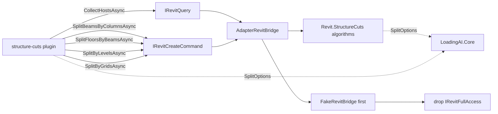

# ADR-0008 — Port structure-cuts onto Bridge

- Status: Accepted
- Date: 2026-09-22
- Deciders: LoadingAI architecture
- Extends: [ADR-0003](0003-fullaccess-exceptions.md)
- Does not supersede: [ADR-0001](0001-bridge-first-hardening.md), [ADR-0002](0002-plugin-shelf-bridge-first.md), [ADR-0003](0003-fullaccess-exceptions.md), [ADR-0004](0004-host-owned-l3-confirm.md), [ADR-0005](0005-port-modeling-tools-onto-bridge.md), [ADR-0006](0006-port-export-tools-onto-bridge.md), [ADR-0007](0007-port-view-tools-onto-bridge.md)

## Context

ADR-0003 lists `structure-cuts` as FullAccess because beam/floor/level/grid splits had no DTO. That freeze forbids a silent Bridge dump: moving a row is a **new ADR**, one plugin or one DTO slice, with FakeBridge tests before deleting `IRevitFullAccess`.

This is the largest row to move. `Plugins/structure-cuts/` shipped 13 `.cs` files; **11 of them reference `Autodesk.Revit`** — the ten algorithm files *and* the handler. Only `SplitOptions.cs` and the `IsExternalInit.cs` polyfill were Revit-free. Unlike ADR-0006 and ADR-0007, the Autodesk surface is not a handful of `Transaction`s around a plugin-owned call: it is **2,771 lines of geometry, parameter copying, native `FamilyInstance.Split` fallbacks and transaction-per-member recovery**. There is no version of this port where the algorithms stay in the plugin, because a Bridge-only plugin drops `Nice3point.Revit.Api.*` and cannot compile a single one of them.

Three facts make the row tractable anyway:

- **The tool boundary is already plain.** Every argument is an id, an enum token, a number, or a boolean: `beamIds[]`, `columnIds[]`, `floorIds[]`, `elementIds[]`, `levelIds[]`, `gridIds[]`, `categories[]`, `scope`, `continueFrom`, `limit`, `dryRun`, `uniqueMark`, `copyParams`. No Autodesk type crosses the plugin edge in either direction.
- **The plugin never used `FullAccess` for anything but `UIApplication.ActiveUIDocument` and its `Document`.** No `Selection`, no `TaskDialog`, no file I/O, no UI. `context.Bridge` already reaches a `Document` on the Revit thread.
- **Everything here is a write**, so the host's native `Confirm L3: {name}?` (ADR-0004) already covers every call, and all four tools are already `ToolTier.L3` / `enabledByDefault: false`. The plugin needs no confirm of its own and no preset change.

The one thing that does *not* move is the plugin's `Options` factory: `DryRun_ReadsThroughSharedHelper_AndSkipsEveryWrite` pins `DryRun = ToolPresets.IsDryRun(json)` inside the plugin, so the shared `SplitOptions` type has to be visible to **both** assemblies rather than relocated wholesale.

## Options considered

1. **Relocate the algorithms to a host subfolder, expose five thin slices (chosen)** — the algorithms keep their shape and their prose reports; only their `using`s and namespace change. A new host folder `src/LoadingAI/Revit/StructureCuts/` is a new pattern for this repo, but it is the only option that keeps the diff reviewable.
2. **Inline the algorithms into `AdapterRevitBridge.cs`, as ADR-0006 did for export-tools** — rejected. `AdapterRevitBridge.cs` is already 2,854 lines and is **not** `partial`; adding 2,771 more lines there is neither reviewable nor possible without first restructuring the class. ADR-0006's precedent does not scale to this row.
3. **Port only some of the four tools** — rejected. A mixed plugin still needs RevitUtil and Nice3point, so it cannot drop the marker or the row. A partial row is not a row you can drop.
4. **Keep the algorithms in the plugin and grow `IRevitBridge` with a generic "run this delegate" escape hatch** — rejected in ADR-0001 P2 and ADR-0002. It would hand `Document` access to a plugin that is supposed to be DTO-only, and it would make the Freeze meaningless.
5. **Give `SplitOptions` to the plugin and let the host take a duplicate copy** — rejected. Two `SplitOptions` types drift silently; the constants (`DefaultLimit = 50`, `MaxLimit = 200`, `DefaultScope = "selection"`) are the tool contract and must have one definition.
6. **Move `SplitMarks` / `SplitReport` / `SplitBatch` to Core too** — rejected by call-site analysis. The plugin never names any of the three; their only callers are host-side, and `SplitBatch` holds `List<Element>`, so it *cannot* live in Core.

## Decision



Port **all four** tools. Keep them in `Plugins/structure-cuts/` (id `structure-cuts`). Do not fold them into `core-tools`.

**Relocate the algorithms.** Move ten files to `src/LoadingAI/Revit/StructureCuts/` (namespace `LoadingAI.Revit.StructureCuts`, folder-matching, `internal`): `BeamSplit` 207, `CurveMemberSplit` 428, `FloorSplit` 462, `GeometryRevit` 595, `GridSplit` 271, `HostCurve` 86, `LevelSplit` 315, `ParamCopy` 171, `SplitElements` 150, `SplitScope` 86. These are 2,771 lines of the 2,845-line payload; the move changes **one line per file** (its namespace).

**Split the one bundling file three ways.** `SplitOptions.cs` held three Revit-free types and the discriminator is *does the handler name this type?* — it names `SplitOptions` and nothing else.

| Type | Home | Why |
|---|---|---|
| `SplitOptions` | **`LoadingAI.Core`** → `src/LoadingAI.Core/Revit/StructureCuts/SplitOptions.cs`, `public` | the handler's `Options` factory constructs it and reads `DefaultLimit` / `MaxLimit` / `DefaultScope`; the algorithms take it as a parameter — one definition both assemblies see |
| `SplitMarks` | **host** → `src/LoadingAI/Revit/StructureCuts/SplitMarks.cs` | Revit-free, but its only callers are host-side (`FloorSplit`, `CurveMemberSplit`); the plugin never names it |
| `SplitReport` | **host** → `src/LoadingAI/Revit/StructureCuts/SplitReport.cs` | `.Progress(SplitBatch)` takes a `SplitBatch`, which holds `List<Element>` |

`SplitOptions` becomes `public` (it was `internal`, and `internal` does not cross assemblies). It has six `get; init;` accessors; `src/LoadingAI.Core/IsExternalInit.cs` already covers them and is **not** guarded, because `LoadingAI.Core` is `netstandard2.0`, which permanently lacks the type. This is not speculative: `LoadingAI.Core/Tools/ToolRegistry.cs` already declares 14 `init` accessors that compile on `netstandard2.0` and under `RevitVersion=2024`.

**`SplitBatch` and all of `SplitScope.cs` stay host-side, untouched.** `SplitBatch` holds `List<Element>`, so it cannot live in Core, and the plugin never names it.

**Delete `Plugins/structure-cuts/IsExternalInit.cs`.** After the move the plugin declares **zero** `get; init;` accessors and zero `required` modifiers — every declaring file left (`SplitOptions` → Core; `FloorSplit` 8 and `ParamCopy` 6 → host) — so the polyfill is provably dead. The governing compiler rule, settled by experiment rather than inference, is that `IsExternalInit` is required only by the assembly that **declares** an `init` accessor, never by one that merely **consumes** one. The plugin's `Options` factory is a six-property object initializer writing all six `init` properties from the plugin assembly, and it compiles without a polyfill because it only consumes them. Consequently a `CS0518` / `CS0656` in the plugin's `net48` build means a file that should have moved host-side did not — a relocation fault, never a signal to reinstate the polyfill.

**Add these signatures:**

```csharp
// IRevitQuery — host collection is a read
Task<ElementIdListDto?> CollectHostsAsync(
    string scope, IReadOnlyList<string>? categories, int limit, int offset,
    CancellationToken ct = default);

// IRevitCreateCommand — every cut produces new elements
Task<SplitResultDto?> SplitBeamsByColumnsAsync(SplitRequestDto request, CancellationToken ct = default);
Task<SplitResultDto?> SplitFloorsByBeamsAsync(SplitRequestDto request, CancellationToken ct = default);
Task<SplitResultDto?> SplitByLevelsAsync(SplitRequestDto request, CancellationToken ct = default);
Task<SplitResultDto?> SplitByGridsAsync(SplitRequestDto request, CancellationToken ct = default);

public sealed record ElementIdListDto(
    IReadOnlyList<string> Ids, int Offset, int Total, string? Error = null);

public sealed record SplitRequestDto(
    IReadOnlyList<string>? HostIds, IReadOnlyList<string>? Cutters,
    IReadOnlyList<string>? Categories, string Scope, int ContinueFrom, int Limit,
    bool DryRun, bool UniqueMark, bool CopyParams);

public sealed record SplitResultDto(
    string Report, int Created, int Openings, int Skipped,
    IReadOnlyList<string> NewIds, string? Error = null);
```

- **The four cuts go on `IRevitCreateCommand`, not `IRevitElementCommand`.** That slice owns in-place mutation (`DeleteElementsAsync`, `MoveElementsAsync`, `ChangeElementTypeAsync`, `PurgeUnusedAsync`); every cut here *produces* new elements, so it belongs with the other creates. `CollectHostsAsync` is a host-collection read and goes on `IRevitQuery`. No new interface, and nothing is added to `IRevitBridge` itself.
- `SplitRequestDto.HostIds` / `Cutters` / `Categories` are **separate lists**, not an encoded token. ADR-0007 had to encode `category` + `name` into one string because its slice took a single `string`; here the fields exist, so they are passed separately. `null` means "all", and an **empty** list is not `null` — a caller holding an empty list passes `ids.Count == 0 ? null : ids`, and `SplitScope.Collect` falls back to `scope`.
- `SplitFloorsByBeamsAsync` passes the **same** `Cutters` list as both the `beamIds` and `columnIds` argument of `FloorSplit.Run`. `SplitElements.Resolve(doc, ids, wanted)` already filters by its `wanted` predicate, so the algorithms separate beams from columns internally and the Adapter needs no encoding.
- `SplitResultDto.Report` carries the algorithms' prose report **verbatim**. Converting it to structured counters would be a rewrite, not a relocation, and `ToolEntry.Handler` is `Func<string, Task<string>>`, so the report *is* the user-visible output.
- `Created` / `Openings` / `Skipped` / `NewIds` are **independent of `Report`** so a partial run never reads as a full one. The algorithms return only a bare `string`, so the counts are surfaced by a host-side `SplitOutcome` collector threaded through each `Run` as a trailing optional parameter `SplitOutcome? outcome = null`, recorded once just before the return. The Adapter creates a **fresh** collector per call, so an early return leaves the counters at zero by construction and every existing message string stays byte-identical.
- The Adapter owns every Autodesk type, `Metric.MmToFt`, `SplitScope.ByScope`, and every `Transaction`. No `File.*` / `Directory.*` / CSV I/O moves into the Adapter — the plugin's report and CSV writing stays in the handler. No `new TaskDialog` outside `ToolGuards`.
- The handler stays plumbing: each returns `result?.Error ?? result?.Report ?? "Please open a model first."`, and `SplitOptions` construction, the preset declarations, the `Version` literal and `ToolPresets.IsDryRun(json)` stay plugin-side.
- **`IRevitFullAccess` is dropped** from `StructureCutsPlugin`, and the `.csproj` drops `LoadingAI.RevitUtil` and both `Nice3point.Revit.Api.*` references — the same 11 lines ADR-0006 and ADR-0007 removed. `LoadingAI.Core` is the plugin's only reference. `LoadingAI.RevitUtil` itself stays: the host still needs `RevitParse`.
- Tiers do not change: all four tools stay `ToolTier.L3`, `enabledByDefault: false`, with their existing presets and `dryRun`. No new preset, no plugin-owned confirm.
- **Order when code lands:** relocate and re-point the contract suite first; implement on `AdapterRevitBridge` **and** `FakeRevitBridge`; lock names in `L3CommandContractTests` with a partition oracle; rewrite the handler; then delete the marker, drop the references, and flip `ShippedPlugin_DoesNotReferenceHost(..., requiresRevitUtil: false)`. Do not delete the marker first.
- This ADR removes the `structure-cuts` row from 0003 in the same PR that lands the code.

## Consequences

- `structure-cuts` becomes Bridge-only. Hosted CI can run all four handlers against `FakeRevitBridge` (`FullAccess` is null).
- `src/LoadingAI/Revit/StructureCuts/` is a **new pattern** for this repo: host-side algorithm subfolders. ADR-0006 inlined its 1,900 lines into `AdapterRevitBridge.cs`, which does not scale; a future layer with a large Autodesk payload should relocate rather than inline.
- `SplitOptions` is now `LoadingAI.Core`'s first Revit-domain options type. It is the plugin's **only** Core dependency for these tools, which is what keeps the dependency surface at Core-only.
- The `Init` polyfill count in the repo is five → four. `Plugins/structure-cuts/IsExternalInit.cs` is gone; `src/LoadingAI.Core`'s stays and must stay unguarded.
- `src/LoadingAI/IsExternalInit.cs` gains a `#if NETFRAMEWORK` guard, because the `init` **declarers** that moved (`FloorSplit` 8, `ParamCopy` 6) land in `src/LoadingAI`, whose TFMs are `net48` / `net8.0-windows` / `net10.0-windows` and lack the type only under `net48`. The guard is a no-op on `net8` / `net10`, where the BCL supplies the type.
- The plugin folder now holds exactly two files: `StructureCutsPlugin.cs` and `plugin.json`.
- `qs-formwork` remains the last FullAccess row until its own ADR.
- Tests that lock this:
  - `L3CommandContractTests` — `CollectHostsAsync` on `IRevitQuery`; the four `Split*Async` on `IRevitCreateCommand`; `DoesNotContain` across the sibling slices, so a method cannot drift between slices.
  - `FakeRevitBridge` implements all five (no-document → `"Please open a model first."`).
  - `FakeBridgeToolTests` — the four handlers, including id-list forwarding, the omitted-list-is-`null`-not-empty rule, the floor beam/column merge, the category filters, `dryRun`, the no-document path and the error-wins-over-report path.
  - `StructureCutsContractTests` — 13 facts, re-pointed to `src/LoadingAI/Revit/StructureCuts/`, including the `AlgorithmsLiveHostSide_NotUnderPlugins` inversion and the sweep extension that keeps the "no `PickObjects`" / "no `new Transaction(`" negatives meaningful now that the plugin folder holds only the thin handler.
  - `ShippedPlugin_DoesNotReferenceHost` `requiresRevitUtil: false` for `Plugins/structure-cuts/StructureCutsPlugin.csproj`.
  - `NonFullAccessPlugins_DoNotMentionAutodeskRevit` covers the folder after the marker is gone. This one matters: it *skips* a folder whose sources mention `IRevitFullAccess`, so a surviving marker would have made it pass **vacuously**.

## Do not

- Do not grow `IRevitBridge` for `qs-formwork` in this ADR.
- Do not add a new Bridge interface; use `IRevitQuery` and `IRevitCreateCommand`.
- Do not put the four cuts on `IRevitElementCommand`; that slice is in-place mutation.
- Do not move `SplitBatch`, `SplitScope`, `SplitMarks` or `SplitReport` to Core; `SplitBatch` holds `List<Element>` and the others have no plugin-side caller.
- Do not add `#if NETFRAMEWORK` to `src/LoadingAI.Core/IsExternalInit.cs`; Core is `netstandard2.0` and guarding it breaks every consumer.
- Do not reinstate `Plugins/structure-cuts/IsExternalInit.cs`, and do not treat a plugin-side `CS0518` as a reason to. A consumer never needs a polyfill; such an error means a declarer did not move.
- Do not move the `Transaction`s, the geometry, `Metric.MmToFt`, `RevitParse` or `SplitScope.ByScope` back into the plugin.
- Do not add filesystem or CSV I/O to the Adapter.
- Do not remove `LoadingAI.RevitUtil` from the repo; the host still needs `RevitParse`.
- Do not renumber, reorder or rename the four tools, and do not change their tiers or `enabledByDefault`.
- Do not change a preset, a `dryRun` default, or add a plugin-owned confirm; ADR-0004 already covers these writes.
- Do not encode `HostIds` / `Cutters` / `Categories` into a single token; pass the separate lists.
- Do not collapse `Created` / `Openings` / `Skipped` / `NewIds` into the `Report` string.
- Do not delete `IRevitFullAccess` on `StructureCutsPlugin` before FakeBridge + contract tests exist.
- Do not reference the host project (`src/LoadingAI`) from the plugin, and do not let the plugin mention `Autodesk.Revit`.
- Do not `new TaskDialog` in the plugin.
