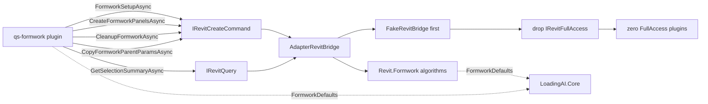

# ADR-0009 — Port qs-formwork onto Bridge and retire FullAccess

- Status: Accepted
- Date: 2026-09-23
- Deciders: LoadingAI architecture
- Supersedes: [ADR-0003](0003-fullaccess-exceptions.md)
- Does not supersede: [ADR-0001](0001-bridge-first-hardening.md), [ADR-0002](0002-plugin-shelf-bridge-first.md), [ADR-0004](0004-host-owned-l3-confirm.md), [ADR-0005](0005-port-modeling-tools-onto-bridge.md), [ADR-0006](0006-port-export-tools-onto-bridge.md), [ADR-0007](0007-port-view-tools-onto-bridge.md), [ADR-0008](0008-port-structure-cuts-onto-bridge.md)

## Context

ADR-0003 lists `qs-formwork` as FullAccess because formwork solids and panels had no DTO. That freeze forbids a silent Bridge dump: moving a row is a **new ADR**, one plugin or one DTO slice, with FakeBridge tests before deleting `IRevitFullAccess`.

`qs-formwork` is the **last** row. ADR-0005 through ADR-0008 moved the other four, so this ADR is not just the fifth port — it is the ADR that empties the table and deletes the escape hatch itself.

This is the second-largest row to move, and it has the same shape as ADR-0008's:

- `Plugins/qs-formwork/` shipped **7 `.cs` files / 1,890 lines**, and **6 of the 7 reference `Autodesk.Revit`** — the four algorithm files *and* the handler. Only the `IsExternalInit.cs` polyfill (15 lines) was Revit-free.
- **The handler is itself Revit-coupled.** `QsFormworkPlugin.cs` was 452 lines with `using Autodesk.Revit.DB;` / `using Autodesk.Revit.UI;`, four `RunRevitAsync` lambdas, and four Revit-typed static helpers. It is **not** "rewritten in place": its Revit-typed members have to leave the file. A Bridge-only plugin drops `Nice3point.Revit.Api.*` and cannot compile a single one of them.

Three facts make the row tractable anyway:

- **The tool boundary is already plain.** Every argument is an id, an enum token, a number, or a boolean: `elementIds[]`, `thicknessMm`, `faceTypes[]`, `collision`, `deleteExisting`, `includeUnselectedLinks`, `action`, `faceType`, `paramNames[]`. No Autodesk type crosses the plugin edge in either direction.
- **The plugin never used `FullAccess` for anything but `UIApplication.ActiveUIDocument` and its `Document`.** No `Selection` (the two selection fallbacks already went through `context.Bridge.GetSelectionSummaryAsync`), no `TaskDialog`, no file I/O, no UI. `context.Bridge` already reaches a `Document` on the Revit thread.
- **Everything here is a write**, so the host's native `Confirm L3: {name}?` (ADR-0004) already covers every call, and all four tools are already `ToolTier.L3` / `enabledByDefault: false`. The plugin needs no confirm of its own and no preset change.

The one thing that does *not* move wholesale is `FormworkConfig.cs`. It reads like a bag of constants, but it holds `BuiltInCategory[] TargetCategories` and a `using Autodesk.Revit.DB;`, so it cannot live in `LoadingAI.Core` as-is.

## Options considered

1. **Relocate the algorithms to a host subfolder, expose one constant (chosen)** — the algorithms keep their shape and their prose reports; only their `using`s and namespace change. Mirrors ADR-0008's `src/LoadingAI/Revit/StructureCuts/` and keeps the diff reviewable.
2. **Inline the algorithms into `AdapterRevitBridge.cs`, as ADR-0006 did for export-tools** — rejected for the same reason ADR-0008 rejected it. The payload is 1,890 lines and `AdapterRevitBridge.cs` is **not** `partial`.
3. **Port only some of the four tools** — rejected. A mixed plugin still needs RevitUtil and Nice3point, so it cannot drop the marker, the row, or the escape hatch. A partial row is not a row you can drop, and here a partial row would leave `IRevitFullAccess` alive.
4. **Move `FormworkConfig` to Core whole and let the host take a duplicate** — rejected. Two `FormworkConfig` types drift silently, and `TargetCategories` cannot be declared in Core at all: `LoadingAI.Core` is `netstandard2.0` with **zero** ProjectReferences and no `Nice3point.Revit.Api.*`.
5. **Keep the algorithms in the plugin and grow `IRevitBridge` with a generic "run this delegate" escape hatch** — rejected in ADR-0001 P2 and ADR-0002. It would hand `Document` access to a plugin that is supposed to be DTO-only, and it would make the Freeze meaningless — the same escape hatch this ADR deletes.
6. **Split `FormworkConfig` by type kind (constants to Core, types to host)** — rejected. The discriminator is **Revit coupling**, not type kind. `TargetCategories`, `FormworkHostInfo`, `FaceInfo`, `FormworkSource`, `PanelCandidate` and `GenerateOptions` all touch Autodesk types or hold Revit-typed members, so type-kind splits them wrongly and leaves a file that still cannot compile in Core.
7. **Expose the whole `FormworkConfig` to the plugin through a Core interface** — rejected. It would expose 40+ members the plugin never reads. The plugin needs exactly one.

## Decision



Port **all four** tools. Keep them in `Plugins/qs-formwork/` (id `qs-formwork`). Do not fold them into `core-tools`.

**Relocate the algorithms.** Move four files to `src/LoadingAI/Revit/Formwork/` (namespace `LoadingAI.Revit.Formwork`, folder-matching, `internal`): `FormworkCore` 437, `FormworkGenerator` 284, `FormworkGeometry` 280, `FormworkParameters` 271. These are 1,272 of the 1,890-line payload; the move changes **one line per file** (its namespace), plus `using System.IO;` in `FormworkParameters.cs` because its `Path` / `Directory` / `File` calls previously resolved through `ImplicitUsings` in the plugin project's own shape.

**Move the handler's Revit-typed members out as host entry points.** The four `RunRevitAsync` lambdas and the four Revit-typed static helpers leave the plugin as `FormworkSetup.Run(UIApplication)`, `FormworkPanels.Run(UIApplication, …)`, `FormworkCleanup.Run(UIApplication, …)`, `FormworkParentParams.Run(UIApplication, …)`, plus a `FormworkPanelQueries` holder for the helpers. They land in `src/LoadingAI/Revit/Formwork/FormworkTools.cs` (310 lines) — the file the Adapter calls. `FormworkPanels.GenerateTimeout` (10 minutes) moves with them and stays Adapter-private, never a Bridge parameter.

**Split `FormworkConfig.cs` by Revit coupling, not by type kind.** The discriminator is *does the plugin name this member at handler scope?*

| Part | Home | Why |
|---|---|---|
| `SheetThicknessMmDefault` = `18.0` | **`LoadingAI.Core`** → `src/LoadingAI.Core/Revit/Formwork/FormworkDefaults.cs`, `public` | the `create_formwork_panels` handler passes it as the `thicknessMm` fallback, so the plugin assembly must see it |
| everything else (`AppId`, `AppVersion`, `SchemaGuid`, `SchemaName`, `SharedParamGroup`, `SharedParamFile`, the 20 numeric tolerances, `MmToFt` / `SheetThicknessFt` / `MinIntersectionVolCuFt` / `DedupCentroidTolFt` / `MinHoleKeepFt` / `PolygonFillMaxDiagFt` / `ArcFillMaxDiagFt`, `TargetCategories`, `AllFaceTypes`, `FacePriority`, `Parameters`, `FaceTypes`, `FormworkParamDef`, `FormworkHostInfo`, `FaceInfo`, `FormworkSource`, `PanelCandidate`, `GenerateOptions`, `GenerateResult`) | **host** → `src/LoadingAI/Revit/Formwork/FormworkConfig.cs` | Revit-coupled or host-only-callers |

**The exposure set is exactly one member, measured by lambda containment.** `FormworkConfig.SheetThicknessMmDefault` is the **only** reference that survives inside a handler body. Every other `FormworkConfig.*` read (`CoverRatioDelete`, `AppId`, `TargetCategories`, …) was inside a `RunRevitAsync` lambda and therefore moved host-side with the lambda, and the plugin never names `FormworkConfig` at all. The extraction is named `FormworkDefaults` rather than reusing `FormworkConfig`, because two same-named public types in one solution is a trap for the next reader; the plugin's `using LoadingAI.Revit.Formwork;` resolves the host namespace and the Core type together without ambiguity.

**Why `FormworkConfig` must be split rather than moved:** it opens with `using Autodesk.Revit.DB;` and declares `public static readonly BuiltInCategory[] TargetCategories`. `LoadingAI.Core` is `netstandard2.0`, has **zero** ProjectReferences, and references no `Nice3point.Revit.Api.*` package, so a `BuiltInCategory` in Core is not a policy violation — it is a compile error. The `Metric.MmToFt` wrappers at `FormworkConfig.cs:35–41` are **not** a split reason: `Metric` is already `public static class Metric` in `namespace LoadingAI.Revit` inside `src/LoadingAI.Core/Revit/Metric.cs`, and those wrappers are Revit-free `double` → `double`.

**Add these signatures:**

```csharp
// IRevitCreateCommand — every formwork tool writes
Task<FormworkSetupResultDto?> FormworkSetupAsync(
    FormworkSetupRequestDto request, CancellationToken ct = default);

Task<FormworkPanelsResultDto?> CreateFormworkPanelsAsync(
    FormworkPanelsRequestDto request, CancellationToken ct = default);

Task<CleanupResultDto?> CleanupFormworkAsync(
    CleanupRequestDto request, CancellationToken ct = default);

Task<CopyParamsResultDto?> CopyFormworkParentParamsAsync(
    CopyParamsRequestDto request, CancellationToken ct = default);

public sealed record FormworkSetupRequestDto();

public sealed record FormworkSetupResultDto(string Report, string? Error = null);

public sealed record FormworkPanelsRequestDto(
    IReadOnlyList<string>? Ids, double ThicknessMm, IReadOnlyList<string>? FaceTypes,
    bool Collision, bool DeleteExisting, bool IncludeUnselectedLinks);

public sealed record FormworkPanelsResultDto(string Report, string? Error = null);

public sealed record CleanupRequestDto(string Action, string? FaceType);

public sealed record CleanupResultDto(string Report, string? Error = null);

public sealed record CopyParamsRequestDto(IReadOnlyList<string>? Ids, IReadOnlyList<string>? Names);

public sealed record CopyParamsResultDto(string Report, string? Error = null);
```

- **The four tools go on `IRevitCreateCommand`, not a new slice.** `formwork_setup` binds shared parameters, `create_formwork_panels` creates DirectShapes, `cleanup_formwork` deletes, and `copy_formwork_parent_params` writes `FW_*` values — all produce or mutate model content, so they belong with the other creates. `GetSelectionSummaryAsync` is an existing `IRevitQuery` read and is **not** re-declared. No new interface, and nothing is added to `IRevitBridge` itself.
- **Each tool gets its own request/result pair rather than a shared `FormworkResultDto`.** The four tools have genuinely different inputs (no args / six args / action + faceType / ids + names), and a shared result would force the plugin to re-derive which counters belong to which call. The result records are deliberately thin — `Report` plus `Error` — because the generator already folds its counters into its prose report and `ToolEntry.Handler` is `Func<string, Task<string>>`, so the report *is* the user-visible output. Converting it to structured counters would be a rewrite, not a relocation.
- `FormworkPanelsRequestDto.Ids` **null means the current selection**, and an empty list is honoured as-is; the handler keeps its `GetSelectionSummaryAsync` fallback and returns `"Please select elements first."` before the Bridge is called, so the plugin still owns that message. `FaceTypes` null or empty means every face type the generator supports.
- `FormworkPanelsRequestDto.ThicknessMm` is **millimetres**, like the tool argument. The Adapter converts with `Metric.MmToFt` when it builds the panel solid; the plugin never converts.
- `CleanupRequestDto.Action` is **already normalised to lower case by the caller** and is one of `stats`, `delete_all`, `delete_by_type`, `cleanup_orphans`; `FaceType` is only consulted by `delete_by_type`. The normalisation stays plugin-side because it is argument plumbing, not a Revit decision.
- `CopyParamsRequestDto.Ids` null or empty means every formwork panel in the model; an empty `Names` asks for the parameter catalogue instead of a copy.
- **The Adapter owns every Autodesk type, `Metric.MmToFt`, `RevitParse.ParseEid`, and every `Transaction`.** A generic `RunFormwork<TDto>` helper mirrors ADR-0008's `RunSplit`: it awaits `_bridge.RunAsync(run, timeout, ct)` when a budget exists and `_bridge.RunAsync(run, ct)` otherwise, then projects the report string through a `Func<string, TDto>`. `FormworkPanels.GenerateTimeout` is the only caller that passes a budget. No `File.*` / `Directory.*` / CSV I/O moves into the Adapter — the plugin had none and gains none. No `new TaskDialog` outside `ToolGuards`.
- The host entry points already return `"Please open a model first."` for a missing document and absorb their own exceptions, so the Adapter adds no error handling of its own.
- The handler stays plumbing: each returns `result?.Error ?? result?.Report ?? "Please open a model first."`. `Error` is checked **first**, matching ADR-0007 / ADR-0008. The `Args` JSON helper struct, the four frozen `Definition` schemas, the two `RequiresWriteConfirm = true` flags, and all four `ToolTier.L3` tiers stay plugin-side and unchanged.
- **`IRevitFullAccess` is dropped** from `QsFormworkPlugin`, and the `.csproj` drops `LoadingAI.RevitUtil` and both `Nice3point.Revit.Api.*` references. `LoadingAI.Core` is the plugin's only `ProjectReference`, with `<Private>false</Private>`. `LoadingAI.RevitUtil` itself stays in the repo: the **host** still needs `RevitParse`.
- Tiers do not change: all four tools stay `ToolTier.L3`, `enabledByDefault: false`. No new preset, no plugin-owned confirm, no `dryRun` change.
- **Order when code lands:** relocate and re-point the algorithms first (Phase A); implement on `AdapterRevitBridge` **and** `FakeRevitBridge`; lock names in `L3CommandContractTests`; rewrite the handler; then delete the marker, drop the references, and flip `ShippedPlugin_DoesNotReferenceHost(..., requiresRevitUtil: false)`. Do not delete the marker first.
- **This ADR also deletes the escape hatch.** With zero listed rows, `IRevitFullAccess` and its support types are dead code. The retirement removes:
  - `src/LoadingAI.Core/Plugins/IRevitFullAccess.cs` — the marker, plus `FullAccessSession` and `IRawRevitAccess`, which the file also declared. `IRawRevitAccess` is invisible to a `rg -i fullaccess` sweep, so the file is deleted **atomically** with its referrers rather than in a separate cleanup pass.
  - `IPluginContext.FullAccess`, `IPluginContextFactory.Create`'s `requestFullAccess` parameter, `PluginLoader`'s `requestFull = typeof(IRevitFullAccess).IsAssignableFrom(pt)` and the `factory.Create(folder, requestFull)` call, `PluginContext`'s `_fullAccessGranted` field / constructor parameter / property / `RunRevitAsync` implementation, and `FakePluginContext`'s `FullAccess => null`.
  - Every test that exercised the path: 18 assertions across `FakeBridgeToolTests` (with 21 `_WithoutFullAccess` test-name suffixes stripped), the two `LoadingAI.RevitTests` call sites, and the `requiresRevitUtil` InlineData row.
- **`ShippedPlugin_DoesNotReferenceHost` keeps its `requiresRevitUtil` parameter.** Only the `qs-formwork` InlineData row flips to `false`. The parameter and its branch stay as a standing forward guard: a future plugin that genuinely needs RevitUtil has a place to declare it, and the default stays "does not".
- **`PluginProjectContractTests`'s oracle body is preserved.** Only the single `Assert.Null(ctx.FullAccess);` line is deleted; the test's 38 `Assert.Contains` + 10 `Assert.DoesNotContain` catalog assertions are untouched. The test is renamed from `QueryViewParamFactories_SucceedWithNullFullAccess` to `QueryViewParamFactories_Succeed`, because with no FullAccess path the qualifier no longer distinguishes anything.
- **`NonFullAccessPlugins_DoNotMentionAutodeskRevit` becomes `ShippedPlugins_DoNotMentionAutodeskRevit`.** The test previously `continue`d past any folder whose sources mentioned `IRevitFullAccess` — an escape hatch that made it pass **vacuously** for every listed plugin. With the table empty, that guard has nothing left to skip and is deleted, so the test now covers every shipped plugin directory unconditionally. This is the reason the marker removal must be `rg`-gated: **no test would have failed** if the marker had survived here.

## Consequences

- `qs-formwork` becomes Bridge-only. Hosted CI can run all four handlers against `FakeRevitBridge`.
- **ADR-0003's listed table is empty and ADR-0003 is Superseded.** No shipped plugin implements `IRevitFullAccess`, references `LoadingAI.RevitUtil`, or mentions `Autodesk.Revit`.
- `src/LoadingAI/Revit/Formwork/` follows ADR-0008's host-side algorithm subfolder pattern. This is the second use, so it is now a convention rather than an experiment: a plugin with a large Autodesk payload relocates rather than inlines.
- `FormworkDefaults` is `LoadingAI.Core`'s second Revit-domain plugin-visible type. It is the plugin's **only** Core dependency for these tools, which is what keeps the dependency surface at Core-only.
- The `Init` polyfill count in the repo is four → three. `Plugins/qs-formwork/IsExternalInit.cs` is gone; `src/LoadingAI.Core/IsExternalInit.cs` stays and must stay unguarded. The plugin declares **zero** `get; init;` accessors after the move, because every declaring file left the folder (`FormworkConfig`, `FormworkHostInfo`, `FaceInfo`, `FormworkSource`, `PanelCandidate`, `GenerateOptions` → host; `FormworkDefaults` is a single `const` → Core).
- `src/LoadingAI/IsExternalInit.cs` gains the two attributes folded in from the deleted plugin polyfill. It stays `#if NETFRAMEWORK`-guarded, because the `init` **declarers** that moved land in `src/LoadingAI`, whose TFMs are `net48` / `net8.0-windows` / `net10.0-windows` and lack the type only under `net48`.
- The plugin folder now holds exactly three files: `QsFormworkPlugin.cs` (218 lines, down from 452), `QsFormworkPlugin.csproj`, and `plugin.json`.
- `PluginProjectContractTests.cs:39`'s `Assert.DoesNotContain("IRevitFullAccess", src)` now passes trivially for every plugin. It is kept as a standing guard against reintroduction.
- **No shipped plugin can reach `UIApplication`.** The only remaining `FullAccess` string in `src/` and `Plugins/` is in guards, prose, and one deliberately-kept test name.
- Tests that lock this:
  - `L3CommandContractTests` — the four `Formwork*Async` on `IRevitCreateCommand`; `DoesNotContain` across the sibling slices, so a method cannot drift between slices.
  - `FakeRevitBridge` implements all four (no-document → `"Please open a model first."`), with four recorded call lists and four typed `Closed*` helpers.
  - `FakeBridgeToolTests` — the four handlers, including the selection fallback, the id-list forwarding, the `thicknessMm` default, the `action` normalisation, the parameter-catalogue path, the no-document path and the error-wins-over-report path.
  - `ShippedPlugin_DoesNotReferenceHost` `requiresRevitUtil: false` for `Plugins/qs-formwork/QsFormworkPlugin.csproj`.
  - `ShippedPlugins_DoNotMentionAutodeskRevit` covers the folder unconditionally after the marker is gone.

## Do not

- Do not add a new Bridge interface; use `IRevitQuery` and `IRevitCreateCommand`.
- Do not grow `IRevitBridge` itself, and do not re-add a "run this delegate" escape hatch to any slice.
- Do not move `FormworkConfig` to Core whole, and do not duplicate it. Split it by Revit coupling.
- Do not move `TargetCategories`, `FaceTypes`, `FormworkHostInfo`, `FaceInfo`, `FormworkSource`, `PanelCandidate`, `GenerateOptions` or `GenerateResult` to Core; they touch Autodesk types or hold Revit-typed members.
- Do not expose a second member beyond `FormworkDefaults.SheetThicknessMmDefault`. The plugin reads exactly one.
- Do not move the `Transaction`s, the geometry, `Metric.MmToFt`, `RevitParse` or the panel queries back into the plugin.
- Do not add filesystem or CSV I/O to the Adapter.
- Do not remove `LoadingAI.RevitUtil` from the repo; the host still needs `RevitParse`.
- Do not put `GenerateTimeout` on a Bridge signature; timeouts stay Adapter-private constants.
- Do not renumber, reorder or rename the four tools, and do not change their tiers or `enabledByDefault`.
- Do not change a preset, add a `dryRun` arg, or add a plugin-owned confirm; ADR-0004 already covers these writes.
- Do not collapse `Error` into `Report`, and do not change the `result?.Error ?? result?.Report` precedence.
- Do not delete `IRevitFullAccess` on `QsFormworkPlugin` before FakeBridge + contract tests exist.
- Do not reference the host project (`src/LoadingAI`) from the plugin, and do not let the plugin mention `Autodesk.Revit`.
- Do not `new TaskDialog` in the plugin, and do not start a plugin-owned `TransactionGroup`.
- Do not reinstate `Plugins/qs-formwork/IsExternalInit.cs`, and do not treat a plugin-side `CS0518` as a reason to. A consumer never needs a polyfill; such an error means a declarer did not move.
- Do not add `#if NETFRAMEWORK` to `src/LoadingAI.Core/IsExternalInit.cs`; Core is `netstandard2.0` and guarding it breaks every consumer.
- Do not re-add a `FullAccess` property, a `requestFullAccess` factory parameter, or a `PluginLoader` grant. The escape hatch is retired, not merely unused.
- Do not delete `ShippedPlugin_DoesNotReferenceHost`'s `requiresRevitUtil` parameter or `PluginProjectContractTests`'s `Assert.DoesNotContain` guards; they are forward guards against reintroduction.
- Do not restore the `continue` guard in `ShippedPlugins_DoNotMentionAutodeskRevit`; it is what made the test pass vacuously for a plugin that still mentioned `Autodesk.Revit`.
