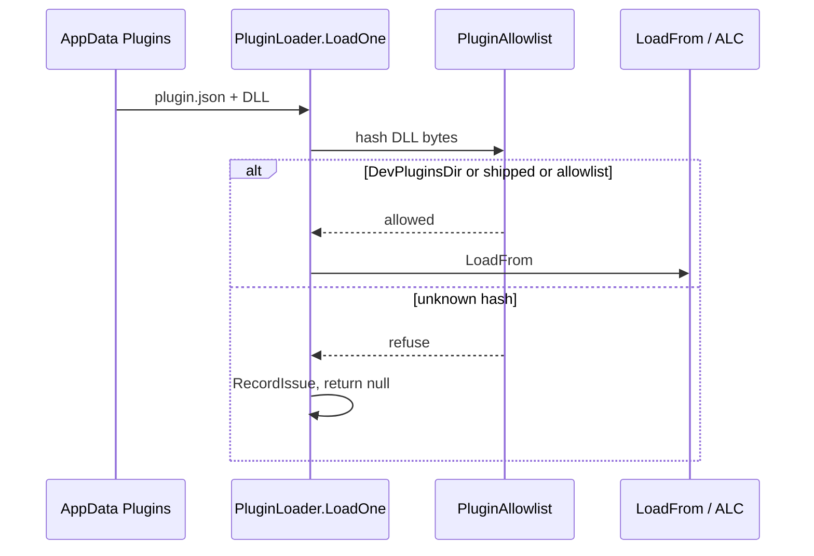

# ADR-0010 — Plugin load SHA-256 allowlist

- Status: Accepted
- Date: 2026-09-20
- Deciders: LoadingAI architecture
- Extends: [ADR-0002](0002-plugin-shelf-bridge-first.md)
- Does not supersede: [ADR-0001](0001-bridge-first-hardening.md), [ADR-0004](0004-host-owned-l3-confirm.md)

## Context

`PluginLoader.LoadOne` did `Assembly.LoadFrom` on any DLL under `%AppData%\LoadingAI\Plugins`. After L3 Confirm that assembly’s write tools can mutate the open model. CONTRIBUTING said an AppData drop (unverified) still works. That is a trust-model hole, not a UI gap.

Stage 1 (this ADR) **refuses** an unknown hash **before** any assembly load. Tools never register, so they cannot reach Confirm L3. Stage 2 (Nova trust prompt) restores drop-in later. Stage 3 is Authenticode. This PR does not implement stage 2 or 3.

## Options considered

1. **SHA-256 host allowlist in the loader (chosen)** — hash DLL bytes in `LoadOne` before `LoadFrom`/ALC. Allow if the folder is under `DevPluginsDir`, or the hash is in `%AppData%\LoadingAI\plugin-allowlist.json`, or the hash is in the shipped set recorded when the host builds CopyPlugin assemblies. Empty/missing AppData allowlist is an empty extra set; shipped plugins still load.
2. **Hash in `plugin.json` / `PluginMeta`** — rejected. A drop-in can claim any hash. `PluginMeta.Verified` stays display-only.
3. **Load unverified read-only / strip L3** — rejected. Stage 1 refuse-to-load. Allowed DLLs keep full L1–L3 (L3 still ADR-0004 Confirm, default No).

## Decision

- Gate lives in `PluginLoader.LoadOne`, before `Assembly.LoadFrom` / `PluginLoadContext`. Plugins stay `IRevitBridge`-only. The adapter does not re-check. This is not a FamilyPaths/ExportPaths sandbox root.
- Mechanism: SHA-256 of **DLL bytes**. Allow if **any** of: folder under **DevPluginsDir**; hash in host-owned `%AppData%\LoadingAI\plugin-allowlist.json`; hash in the **shipped set** next to `LoadingAI.dll` (`plugin-shipped-hashes.json`), recorded when the host runs `BuildShippedPlugins`.
- Empty or missing allowlist must **not** fail-closed on shipped plugins (fresh install still loads core-tools and the other five). Unknown hash must **not** fail-open.
- Refuse: `RecordIssue` + return null. Hint names the **absolute** `DevPluginsDir` (`...\Addins\<year>\LoadingAI\Plugins\dev`) — the folder `Discover` scans, which may not exist yet (no auto-create) — or instructs recording the SHA-256 (stage 2 will add a trust dialog). No `new TaskDialog` in the loader.
- Host `RecordShippedHashes` after `BuildShippedPlugins` writes `$(TargetDir)plugin-shipped-hashes.json`. `CopyAddin` copies it next to the host. `pack-addin.ps1` writes the same file from the staged plugin DLLs so a zip install is not fail-closed. Rebuild the **host** after a plugin binary change so the shipped set refreshes. `SkipHostPluginBuild` skips the host target (CI injects temp paths; tests never `Discover()` live AppData).
- `PluginMeta.Verified` is **not** a gate.

## Consequences

- CONTRIBUTING “AppData drop, unverified, still works” **stops** for unknown hashes until stage 2.
- Unsigned `plugin.json` + DLL in `%AppData%\LoadingAI\Plugins\evil\` → Settings load issue, tools absent, cannot reach Confirm L3. Same DLL under the absolute add-in `DevPluginsDir` (`...\Addins\<year>\LoadingAI\Plugins\dev`) still loads; next L3 still Confirm default No.
- `"verified": true` with an unknown hash does **not** load.
- Tests: `PluginAllowlistTests` (unknown Runtime refused; Dev allowed; listed hash allowed; empty allowlist + shipped hash allowed). Source-lock: gate before `LoadFrom`; refusal hint embeds the absolute `DevPluginsDir`.

## Do not

- Do not consult `plugin.json` / `PluginMeta.Verified` as a load gate.
- Do not fail-open on an unknown hash (load anyway, load-unverified-writable, or load-read-only).
- Do not fail-closed on shipped plugins when the AppData allowlist is empty or missing.
- Do not strip L3 from an allowed DLL. L3 stays ADR-0004 Confirm, default No.
- Do not `new TaskDialog` in the loader (stage 2 is Nova).
- Do not put the allowlist hash in `plugin.json`. Do not widen FamilyPaths/ExportPaths. Do not change `IRevitBridge` or Authenticode (`trust-addin.ps1`) in this slice.
