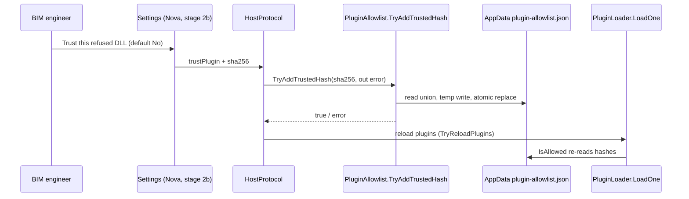

# ADR-0011 — Plugin trust prompt (user-initiated allowlist write)

- Status: Accepted
- Date: 2026-09-20
- Deciders: LoadingAI architecture
- Extends: [ADR-0010](0010-plugin-load-allowlist.md)
- Does not supersede: [ADR-0001](0001-bridge-first-hardening.md), [ADR-0004](0004-host-owned-l3-confirm.md), [ADR-0010](0010-plugin-load-allowlist.md)

## Context

Stage 1 (ADR-0010) refuses an unknown AppData DLL before any assembly load, so its tools never register and cannot reach Confirm L3. That is safe but leaves no way for the BIM engineer to accept a plugin they built themselves: editing `%AppData%\LoadingAI\plugin-allowlist.json` by hand is the only route.

Stage 2 restores an explicit, user-driven path to trust one DLL. Trigger is **confirmed**: the engineer clicks **Trust** in Settings for a refused DLL. It is **not** an automatic dialog on first sight of an unknown DLL. Stage 3 (Authenticode) stays out.

This slice is the host-owned **writer** only: no UI, no dialog, no gate change.

## Options considered

1. **User-initiated trust, host-owned writer, union append to the existing list (chosen)** — the click is the authorisation; the host hashes and appends the SHA-256 to the same `plugin-allowlist.json` the gate already reads. Default No: nothing is trusted without a click.
2. **Automatic dialog on first unknown DLL** — rejected by the engineer. An "unknown plugin wants in" prompt fires once per rebuilt DLL and trains the user to click Yes; the click must be deliberate, from Settings, on a plugin the engineer chose to install.
3. **Trust by `plugin.json` hash or plugin id / name** — rejected. A drop-in can write any hash or reuse any id, so trusting by manifest re-opens the stage-1 hole. `PluginMeta.Verified` stays display-only.
4. **Second wrapper file (`{"trusted":[…]}`) or a separate trust store** — rejected. Two files that can disagree is two trust models; the gate must read one list.
5. **Overwrite the file with the writer's own list** — rejected. Hand-edited entries and previously trusted plugins would be dropped, and `LoadHashes` reports an **empty** set for a file it cannot parse, so a blind overwrite after a read failure would silently un-trust everything.
6. **Trust read-only / strip L3 from a newly trusted DLL** — rejected. After a click the DLL is trusted; it keeps full L1–L3, with L3 still ADR-0004 Confirm, default No.

## Decision

- **Trigger**: a click in Settings on a refused DLL. Default **No**. No automatic prompt, no silent trust, no trust from the web view.
- **Writer**: `PluginAllowlist.TryAddTrustedHash(string sha256, out string error)`. The host owns the file; the UI never writes it and never computes the hash.
- **File**: the one existing `%AppData%\LoadingAI\plugin-allowlist.json` — a plain JSON `string[]` of 64-hex SHA-256 values, indented. No wrapper object, no second file.
- **Write is union + de-dup**: read existing entries, keep them (hand edits included), append the new hash, write. A repeat click is a no-op. Order is preserved and new hashes append.
- **Atomic replace**: write a temp file in the same directory, then `File.Replace` when the destination exists, else `File.Move`. (`File.Move(src, dst, overwrite: true)` does not exist on .NET Framework 4.8 — Revit 2024 builds `net48`.) A crash cannot truncate the list into an empty fail.
- **Writes are serialised**: the writer holds a dedicated static lock across the whole read-modify-write, so concurrent clicks cannot lose an append.
- **Unreadable existing file aborts**: if the file exists but cannot be parsed, the write fails with an error and the bytes are left alone. Never overwrite a file the gate would then read as empty.
- **Only the parent directory of `AllowlistPath` may be created** (`%AppData%\LoadingAI`). The writer never calls `CreateDirectory(DevPluginsDir)`.
- **64-hex validation before write**, so a malformed string never reaches the file the gate parses.
- **The refusal carries the hash**: `PluginLoadIssue.Sha256` (appended last, default `""`) is populated at the gate so the UI has the exact value to trust.
- **No cache invalidation API**: `IsAllowed` re-reads the hashes on every call, and same-session reload already exists (`PluginLoader.TryReloadPlugins`). The write therefore takes effect for the next load without restarting Revit.
- **Trust is per hash (per DLL bytes)**, not per plugin id. Rebuilding a plugin changes its hash → re-trust. Use the absolute `DevPluginsDir` for the rebuild loop.
- **Nova owns stage 2b** (Settings action + native `TaskDialog`). This ADR's PR is the writer only.

## Consequences

- CONTRIBUTING “AppData drop, unverified, still works” stays **closed** for unknown hashes until the engineer clicks Trust; it is no longer closed *permanently*.
- A trust decision is durable host state in AppData, not a per-session flag; the gate, the shipped set, and `DevPluginsDir` behave exactly as in ADR-0010.
- An unknown hash still refuses until written, and `"verified": true` still is not a gate.
- Hand-editing `plugin-allowlist.json` still works — the writer unions rather than replaces.
- A refused DLL that is then trusted keeps full L1–L3, with L3 still Confirm default No.
- Residual risk: the click is the whole authorisation. Trusting a DLL the engineer did not build is a real model/data risk (its write tools reach L3 Confirm). Stage 3 Authenticode is the mitigation, not a later gate here.
- Tests: `PluginAllowlistTests` cover create-when-missing, union + de-dup + preserved entries, unreadable → abort with bytes intact, non-hex rejection, uppercase normalisation, unwritten still refused, shipped hash still allowed with an empty allowlist, and “creates the allowlist parent, not DevPluginsDir”. Source-locks keep the single `CreateDirectory(dir)` and the hash-carrying refusal in `PluginLoader`.

## Do not

- Do not add `new TaskDialog` (or any UI) to `PluginLoader`. Stage 2b is Nova.
- Do not trust automatically on first sight of an unknown hash, or default the answer to Yes.
- Do not trust by plugin id, name, folder, or a hash in `plugin.json` / `PluginMeta.Verified`.
- Do not fail-open: an unreadable allowlist aborts the write; an unknown hash still refuses until it is written.
- Do not fail-closed on shipped plugins when the AppData allowlist is empty or missing (unchanged from ADR-0010).
- Do not `CreateDirectory(DevPluginsDir)`, and do not add a second allowlist file or a wrapper object.
- Do not change `IsAllowed`, `LoadHashes`, or `HashFile` semantics in this slice; do not write the allowlist from the web view.
- Do not widen `FamilyPaths` / `ExportPaths`, change `IRevitBridge`, or touch Authenticode / `trust-addin.ps1` (stage 3).
