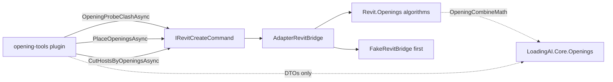

# ADR-0012 — Port opening-tools onto Bridge

- Status: Accepted
- Date: 2026-09-22
- Deciders: LoadingAI architecture
- Does not supersede: [ADR-0009](0009-port-qs-formwork-onto-bridge.md), [ADR-0010](0010-plugin-load-allowlist.md), [ADR-0011](0011-plugin-trust-prompt.md)

## Context

Historic `opening-tools` (commit `35e7094`) placed and punched voids where MEP clashed a host, and repaired the cut after a family reload. That commit is FullAccess and is not an ancestor of main. Cherry-picking it fails CI.

The tool boundary is already plain: element ids, a shape token, millimetres, a family name, a level name, a limit, and (new) `dryRun`. No Autodesk type has to cross the plugin edge.

This is a restore of two tools, not a new product and not a change to structure-cuts. Host `StructureCuts` stays at 14 files. structure-cuts `plugin.json` stays `2.0.1`. `ToolSelector.DefaultMax` stays 24.

## Options considered

1. **Formwork-style, three host slices (chosen)** — `OpeningProbeClashAsync` plans and does not write, `PlaceOpeningsAsync` writes the probe result, `CutHostsByOpeningsAsync` repairs. The plugin calls probe then place, and skips place on `dryRun`.
2. **Four methods (Probe / Combine / Place / Repair)** — rejected. Combine math is not a document write and does not need its own bridge method.
3. **Keep `IRevitFullAccess` on this plugin** — rejected. One plugin is Bridge slices, never FullAccess.
4. **Leave combine math in the plugin** — rejected. It is Revit-free. One definition lives in Core so the host and the tests cannot drift.

## Decision

Port both tools. Keep them in `Plugins/opening-tools/` (id `opening-tools`, version `1.0.0`). Do not fold them into `core-tools` or `structure-cuts`.

The plugin project references Core only (`requiresRevitUtil: false`). It does not reference Nice3point `RevitAPI` / `RevitAPIUI` and does not implement `IRevitFullAccess`. Plugin `.cs` does not mention `Autodesk`.

Algorithms live in `src/LoadingAI/Revit/Openings/`. `OpeningCombineMath` lives once in `src/LoadingAI.Core/Openings/OpeningCombineMath.cs`. Historic tests move to `src/LoadingAI.Tests/OpeningCombineTests.cs`.

Family load is host-side inside the Opening slice. The four historic `.rfa` ship next to the plugin (`CopyToOutputDirectory`, `CopyPlugin`, `pack-addin.ps1`). Do not retrofit `load_family`.

`create_openings_from_clash` calls probe then place, and skips place when `dryRun`. `dryRun` counts only. `limit` defaults to 50 and caps at 200. `clearanceMm` defaults to 25. Units are millimetres at the tool boundary. L3 confirm stays host-owned. Host pick stays host-owned — the plugin does not call `Selection.PickObjects`.

A section box is not a host. Linked MEP uses `GetTotalTransform` on the host side only. The repair tool skips linked hosts. Honest skips (no host, no MEP, linked host, no family, one-storey leftover, envelope too wide) are reported. A silent Autodesk exception is never a success.

## Consequences

Shipped plugins go from six to seven. Ship-list literals that said 6 become 7: host `ShippedPlugin`, `pack-addin.ps1` (including the four `.rfa`), `ScriptContractTests`, `PluginProjectContractTests`, the test project reference, and the solution.

`ToolSelector.DefaultMax` is not raised. If a catalog test proves the two new names cannot fit under 24, stop — do not bump the cap in this PR.

ADR-0010 and ADR-0011 stay as they are. Status is **Accepted**: an independent review accepted the landed port and the engineer accepted that review.

## Do not

- Cherry-pick `35e7094` onto main.
- Invent BIM host or MEP element ids, or add a third tool.
- Dump `Document` or `UIApplication` across the bridge.
- Put a second copy of combine math in the plugin.
- Load families from the plugin with `Family.LoadFamily`.
- Touch StructureCuts, column-stack, or ADR-0010 / ADR-0011 content.
- Raise `ToolSelector.DefaultMax`.
- Show a plugin-owned confirm dialog.
